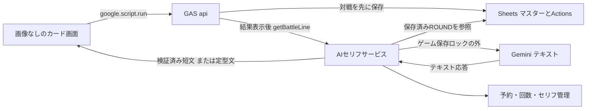

# 02 アーキテクチャ — スキルじゃんけんラボ

反映日：2026年10月26日。初期資料（退避済み）：[01_企画書.md](archive/スキルじゃんけんラボ_企画・仕様・設計/01_企画書.md)・[02_仕様書.md](archive/スキルじゃんけんラボ_企画・仕様・設計/02_仕様書.md)・[03_設計基礎書.md](archive/スキルじゃんけんラボ_企画・仕様・設計/03_設計基礎書.md)（v1.0）。

本書は提案仕様をプロジェクト用に整理した設計文書。アプリ実装・受入試験・公開は未完了であり、実績や試験合格を示さない。参照元と本書の役割・更新規約は[索引](00_index.md)を参照。

## 技術の役割

| 技術 | 初版での役割 |
|---|---|
| Google Apps Script（GAS） | 画面配信、入力検証、勝敗・ポイント計算、保存、対戦後のセリフ取得 |
| Google Sheets | キャラ・スキル・対応表・レシピ・行動記録の保存と教材用の可視化 |
| Google Drive | Sheetsの非公開確認とバックアップ。画像用途は廃止 |
| Gemini | 保存済み対戦の短いセリフ。画像生成・勝敗の決定には使わない |
| HTML/CSS/JavaScript | 縦画面、カード、ボタン、短い演出、学習表示 |

テキスト用モデルの無料枠・利用可能性を実装時に確認する。画像生成とWebP制作・配信は廃止。公式資料の出典と確認範囲は[文書索引](00_index.md)に記載する。

## 全体構成



画面はGASの `doGet()` が返すHTML Service。画面からサーバーへの通信は非同期の `google.script.run` を使う。[Webアプリの公式説明](https://developers.google.com/apps-script/guides/web)、[HTML Serviceの通信](https://developers.google.com/apps-script/guides/html/communication)。

初版は同じGAS内の画面とサーバーを使い、独立したRESTサーバーや別ホスティングを用意しない。画像生成は廃止。AIセリフはゲーム変更の保存完了後に別RPCで取得する。

## 実装ファイルの責務

下表は現行Web v2の実装棚卸し。画像関連の行は継続採用の意味ではなく撤去対象である。新設計のサービス境界と入力・回数管理は[AIセリフ設計](specs/ai-battle-dialogue.md)、ファイル単位の変更は[実装タスク](tasks/02_backlog/ai-battle-dialogue.md)を参照する。

| 実ファイル／後続の責務 | 責務 |
|---|---|
| src/server/controllers/web.js・api.js | doGet/include_、公開api、共通応答。実装済み |
| src/server/core/request.js・errors.js・settings.js | 6操作の入力検証、安全なエラー、Script Properties読込。実装済み |
| src/server/application/services.js | 読取りサービスへの配線。GameServiceの抽選・対戦・合成は後続実装 |
| Rules（後続） | 勝敗、ポイント、レシピ正規化の副作用のない関数 |
| src/server/adapters/external.js | Repository・Assets・Geminiの実アダプターへの配線。設定不足時はエラーで停止 |
| src/server/controllers/admin.js・core/lock.js | 新規8表作成、排他、WebP登録。設定済みブックを上書きしない。controllers/backup.jsは別ブックへの検証付きコピー・復元 |
| src/server/db/schema.js・repository.js | 型・ヘッダー・初期マスターを検証し公開項目だけ返す。全Actionsを検証し最新stateを復元。db/actions.jsでロック内の追記・再送・上限判定を実装 |
| src/server/services/assets.js・gemini.js | 非公開所有確認、WebP寸法・容量検証、画像パート抽出、生成元のDRAFT保存 |
| src/client/index.html・styles.html | 読込・初期記録・失敗・再試行の最小画面。5画面は後続 |
| src/client/core/dom.html・api.html・app.html | DOM、安全な文字表示、全応答を保持するRPC、初期読込と所有仲間1枚の画像取得・失敗時の名前表示。core/pending.htmlは送信前保存・手動再送・最新化、core/assets.htmlは版別メモリキャッシュ。ゲームの結果演出は後続 |
| scripts/・tests/ | ローカルビルド・プレビュー・GASモック・ブラウザ検証。GAS配置には含めない |

内部・管理関数は末尾 `_` を付け、画面から呼ぶ公開関数は `api` に集約する。末尾 `_` の関数は `google.script.run` から呼び出せない。ただし、これは公開範囲の設定や入力検証の代替ではない。[公式通信ガイド](https://developers.google.com/apps-script/guides/html/communication)。

2026-10-26、①土台作成として上記の最小構成を実装した。コピー元に合わせてGASサーバーを通常のJavaScriptファイルに分割し、GAS上では同じ大域で実行する。Node側のscripts/testsはES modulesを使用する。トップレベルで別ファイルの初期化順に依存しない。

`npm run build` は明示的な許可リストにある13実行ファイルと.claspignoreだけをdistへ出力する。配置先・認可・claspによる転送は②で設定し、現時点ではアップロードしない。実サービスが未接続の配布物は初期状態を偽装せずエラーになり、ローカルプレビューだけがtestsの仮データを利用する。

## Golden Pathと構成要素

[要件のGolden Path](01_requirements.md)と同じ番号で対応付ける。

| # | ステップ | 構成要素・API | 境界・保存先 | 失敗時の影響 |
|---|---|---|---|---|
| 1 | 起動 | Code / Client / Repository、bootstrap | Googleアクセス制御、Sheetsマスター・Players・Actions | 権限不足・不整合で起動または変更を停止 |
| 2 | 仲間獲得 | GameService / Rules / Repository、drawCharacter | ScriptLock、Actionsの所有スナップショット | 保存できなければ演出しない |
| 3 | 対戦・ポイント獲得 | GameService / Rules / Repository、playRound | 所有・習得・適性・手の検証、Actions | 結果未確定なら同一要求の再送で解決 |
| 4 | 合成 | GameService / Rules / Repository、synthesize | Recipes、Actionsのポイント・習得 | 二重消費・二重解放を防止 |
| 5 | S04使用 | Client / GameService / Rules、playRound | CharacterSkillsの既存適性、習得状態 | 適性と習得の混同を防止 |
| 6 | 学習表示 | Client / Repository、getRelations | Players→Actions、Characters↔CharacterSkills↔Skills | 実データに一致しなければ学習要件未達 |
| 7 | 再開 | Client / Repository、保留要求解決→bootstrap | sessionStorageとSheets最新状態 | 過去の再送結果で画面を巻き戻さない |

画像配信getAssetは撤去対象。新仕様は画像ファイルを必要とせず、GAS・Sheets・認証がゲームの中核依存となる。テキストAIは演出に使い、生成失敗が保存や次の操作を妨げない。

## 通信操作と状態変更

画面は `google.script.run` からサーバー関数 `api(request)` を呼び出す。REST APIとしては公開しない。完全なJSON契約は本書の[API契約](#api契約)を参照。

| 操作名 | 目的 | 状態変更 |
|---|---|---|
| bootstrap | マスター・最新状態取得 | なし |
| drawCharacter | 未所有仲間を1体獲得 | 所有追加 |
| playRound | 1回のじゃんけん | ポイント加算 |
| synthesize | 固定レシピで習得 | ポイント消費・習得追加 |
| getRelations | 学習用の関係と最新記録取得 | なし |
| getBattleLine | 保存済み対戦に対するセリフ | ゲーム状態なし。生成予約・日次回数・セリフ保存のみ |

変更要求には一意の `requestId` と画面が読んだ `expectedVersion` を付ける。同じ要求を再送すると保存済みの結果を返し、二重に適用しない。別の操作で状態が進んでいたら更新競合として再読込を案内する。

## API契約

### 公開入口と共通形式

`api(request)` を `google.script.run.withSuccessHandler(...).withFailureHandler(...).api(request)` で呼ぶ。通信順序に依存せず、画面側は変更を1件ずつ送る。JSONで表せる型のみを使用し、Dateオブジェクトではなく日時文字列を返す。

変更要求例：

```json
{
  "op": "playRound",
  "requestId": "68bc9177-bae2-4b17-ae17-b2cabf5cdf72",
  "expectedVersion": 2,
  "payload": {
    "characterId": "C01",
    "skillId": "S01",
    "hand": "rock"
  }
}
```

成功応答例（変更前ポイント2、相手がチョキの場合）：

```json
{
  "ok": true,
  "requestId": "68bc9177-bae2-4b17-ae17-b2cabf5cdf72",
  "replayed": false,
  "version": 3,
  "data": {
    "result": {
      "characterId": "C01",
      "skillId": "S01",
      "playerHand": "rock",
      "cpuHand": "scissors",
      "outcome": "WIN",
      "basePoints": 2,
      "bonusPoints": 1,
      "earnedPoints": 3
    },
    "state": {
      "schemaVersion": 1,
      "version": 3,
      "points": 5,
      "ownedCharacterIds": ["C01", "C02", "C03"],
      "unlockedSkillIds": ["S01", "S02", "S03"]
    }
  }
}
```

失敗応答例：

```json
{
  "ok": false,
  "requestId": "a4a45a39-92a0-4112-8a18-596a9553c9af",
  "error": {
    "code": "INSUFFICIENT_POINTS",
    "message": "あと1ポイントためよう",
    "retryable": false,
    "details": {"required": 3, "current": 2}
  }
}
```

業務エラーも成功ハンドラーにこの形式で返す。GASやネットワークの例外は失敗ハンドラーで扱い、変更結果は未確定とする。読み取り応答はrequestId=null、replayed=false。versionは状態を含む読み取りと変更成功で返し、セリフ応答では省略する。

### 操作別契約

| op | payload | 成功時のdata | 主な検証 |
|---|---|---|---|
| bootstrap | `{}` | `{player, state, characters, skills, characterSkills, recipes, masterVersion, limits}` | 初期状態・全マスター・Actionsの整合性 |
| drawCharacter | `{}` | `{result:{characterId, candidateCount}, state}` | 未所有候補がある |
| playRound | `{characterId, skillId, hand}` | `{result:{characterId, skillId, playerHand, cpuHand, outcome, basePoints, bonusPoints, earnedPoints}, state}` | 所有、習得、適性、手の許可値 |
| synthesize | `{ingredientSkillIds:["S01","S02"]}` | `{result:{recipeId, unlockedSkillId, spentPoints}, state}` | 配列長2、重複なし、固定レシピ、習得、未解放、残高 |
| getRelations | `{}` | `{player, recentActions, characters, skills, characterSkills, ownedCharacterIds, unlockedSkillIds}` | 最新10件のみ。トークンや内部パスを除く |
| getBattleLine | `{roundRequestId:"UUID"}` | `{roundRequestId,text,source:"ai"\|"preset"}` | P001の保存済みROUNDのみ。生成済み・予約済みは再生成しない |

bootstrapのplayerは `{playerId, displayName}`。charactersは `{characterId,name,assetId}`、skillsは `{skillId,name,effectCode,bonus,assetId}`、characterSkillsは `{characterId,skillId}`、recipesは `{recipeId,ingredientA,ingredientB,resultSkillId,cost}` の配列。limitsは `{maxActions:200,remainingActions:n}`。

recentActionsは `{actionId,type,createdAt,result}` の配列で新しい順。payloadHashや入力の内部記録は返さない。getRelationsのversionは対応する状態のversion。Assetsは既存データ互換用に残すレガシー表となり、ゲームは参照しない。

playerIdはクライアントから受け取らず、初版サーバー内でP001と決める。未知のop、未知のキー、必要項目不足を拒否する。変更要求全体は4KB以下、IDは英数字・`_`・`-`の32文字以内、requestIdはUUID形式に限定する。

①土台作成時点の共通入口では、読取り要求を `{op,payload}`、変更要求を `{op,requestId,expectedVersion,payload}` として検証する。requestIdはUUIDの版1〜8・標準variant、expectedVersionは0以上の安全な整数。要求サイズはJSON.stringify後のUTF-8バイト数で4096以下とする。6操作の入力形式は実装済みだが、実データ読込・ゲーム処理の合格を意味しない。

## 保存・実行境界

- 状態変更は `drawCharacter` / `playRound` / `synthesize` の3操作。画面は1件ずつ送信し、成功保存を確認してから結果を演出する。
- 8シート、1行追記、ScriptLock、再送と状態復元の詳細は[データモデル](05_data_model.md)。Sheetsの複数表更新をDBトランザクションとみなさない。
- 認可は提供者本人限定の公開設定を前提とする。公開APIに任意playerId・Drive fileId・シート名・URLを指定する機能を作らない。内部関数の末尾 `_` は認可・入力検証の代替ではない。
- キャッシュは補助のみ。最新状態・重複判定の正本はSheetsとする。文字列はtextContent等で表示し、任意HTML・コードを実行しない。
- GASの実行時設定はScript Properties。`env/` と `doppler.yaml` は既存の開発用ひな形で、GASへの同期は未実装。設定と秘密情報の置き場所は[データモデル](05_data_model.md)に従う。
- ユーザー向けエラーは[エラー方針](06_error_policy.md)、配置・共有制限は[リリース手順](08_release_runbook.md)に従う。

## 拡張時の変更箇所

| 拡張 | 追加・変更が必要なこと | 初版との境界 |
|---|---|---|
| キャラ・固定スキル追加 | マスター、図形カード、定型セリフ、適性、受入条件の更新 | 効果コードが既存ならロジック追加は不要 |
| 新しい効果 | Rulesの許可コード・表示・試験を追加 | AIが任意コードや効果値を決めない |
| 3素材以上の合成 | RecipeIngredientsと数量、在庫消費を設計 | 初版の2素材・非消費とは別仕様 |
| 個別プレイヤー | 認証、主体からのID解決、所有権検証、記録分離 | 固定P001を置き換える |
| 教室での同時利用 | 負荷測定、運用管理、保存先選定 | ScriptLockの全体直列化がボトルネックになる |
| DBへの移行 | PlayerCharacters、PlayerSkills、対戦表、取引・一意制約 | JSONスナップショットを正規化した現在状態へ移す |
| 対戦以外のAI会話 | 別途の目的・入力・回数・内容確認の設計が必要 | 初版は対戦後の一言のみ。画像生成は廃止 |
| 一般公開 | 認証、監視、レート制限、年齢に応じた運用、問い合わせ・削除 | 公開設定の変更だけでは足りない |

## 開発ガイドとの関係

共通作業方針は[AGENTS.md](../AGENTS.md)、Claude Code固有の手順は[CLAUDE.md](../CLAUDE.md)を参照する。構造・IFの変更は[MVP実装計画](tasks/02_backlog/mvp-implementation.md)等でScopeと検証方法を決め、確定した判断を本書または `docs/adr/` に残す。

### ゲーム実装へ渡す境界（③）

`commitAction_(request, produce, book?)` は入力検証→ScriptLock→全表読込→requestId→version→200件上限の順に判定し、初回だけ `produce(state, normalizedPayload, tables)` を呼ぶ。戻り値は `{result,state}`。Actionsの保存済み結果と状態差分の検証は `validateStoredTransition_` が行い、乱数は引かない。後続GameServiceは所有・習得・適性・残高等の業務エラーを判定して実結果を生成し、この境界へ接続する。ゲーム3操作の公開サービスは現時点で停止するため、疎通用加点APIは存在しない。

クライアントは `App.commands.start(op,payload,expectedVersion)`、`retry()`、`sync()` を使用する。startはbootstrap同期後のみ許可し、保留中・通信中・保存領域利用不可・未同期は変更ボタンを無効にする。retryは当該操作の結果と最新bootstrapを分けて返す。演出は保存成功を確認してから行う。
