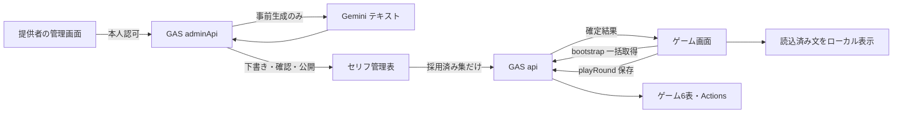

# 02 アーキテクチャ — スキルじゃんけんラボ

反映日：2026年10月26日。初期資料（退避済み）：[01_企画書.md](archive/スキルじゃんけんラボ_企画・仕様・設計/01_企画書.md)・[02_仕様書.md](archive/スキルじゃんけんラボ_企画・仕様・設計/02_仕様書.md)・[03_設計基礎書.md](archive/スキルじゃんけんラボ_企画・仕様・設計/03_設計基礎書.md)（v1.0）。

本書は現行仕様を定義する。ローカル実装・検証済み範囲と未完了の実環境確認は[最新記録](tasks/03_active/mvp-release-verification.md)および[テスト戦略](07_test_strategy.md)で区別する。参照元と本書の役割・更新規約は[索引](00_index.md)を参照。

## 技術の役割

| 技術 | 初版での役割 |
|---|---|
| Google Apps Script（GAS） | 画面配信、入力検証、勝敗・ポイント計算、保存、起動時の採用済みセリフ集取得 |
| Google Sheets | キャラ・スキル・対応表・行動記録の保存と教材用の可視化 |
| Google Drive | Sheetsの非公開確認とバックアップ。画像用途は廃止 |
| Gemini | 管理画面での事前生成のみ。プレイ中の生成・画像生成・勝敗の決定には使わない |
| HTML/CSS/JavaScript | 縦画面、カード、ボタン、短い演出、学習表示 |

テキスト用モデルの無料枠・利用可能性を実装時に確認する。画像生成とWebP制作・配信は廃止。公式資料の出典と確認範囲は[文書索引](00_index.md)に記載する。

## 全体構成



画面はGASの `doGet()` が返すHTML Service。画面からサーバーへの通信は非同期の `google.script.run` を使う。[Webアプリの公式説明](https://developers.google.com/apps-script/guides/web)、[HTML Serviceの通信](https://developers.google.com/apps-script/guides/html/communication)。

初版は同じGAS内の画面とサーバーを使い、独立したRESTサーバーや別ホスティングを用意しない。画像生成は廃止。AIセリフは管理画面で事前生成・採用する。ゲームはbootstrapに同梱された集から選ぶ。対戦ごとのセリフ通信や生成は行わない。

## 実装ファイルの責務

以下はローカル実装。実GASは旧Web v2のまま。

| 実ファイル | 責務 |
|---|---|
| controllers/web.js・api.js | ゲーム4操作とHTML配信 |
| controllers/dialogue-admin.js・core/access.js | 管理APIと実利用者の認可、非公開所有確認 |
| application/services.js・services/game.js | 抽選・勝敗・加算と保存の配線 |
| adapters/external.js | bootstrap・関係情報・採用集の読取 |
| db/schema.js・repository.js・actions.js | 物理2／マスター2・型付き記録・状態復元・追記・再送・上限 |
| db/legacy.js・legacy-schema.js | 旧物理1（マスター1・2）の読取り・バックアップ用検証。旧操作を公開しない |
| controllers/admin.js・backup.js | 新規ブック作成、旧マスター2の別ブック移行、検証付きバックアップ・切替 |
| services/dialogue.js・gemini.js | 下書き・公開版・生成予約・回数制限・テキストAPI |
| client/index.html・app.html・styles.html | ゲーム4画面、結果、学習表示 |
| client/core/pending.html・dialogue.html | データセット別保留、手動再送、セリフのローカル選択 |
| client/admin.html・admin-app.html | 候補生成・確認・選択・公開・解除 |
| scripts/・tests/ | 配布しない開発・検証コード |

公開関数はdoGet・api・adminApiのみ。内部は末尾 `_`。管理入口はすべて実利用者認可を行う。GASは同じ大域で実行し、トップレベルの初期化順に依存しない。buildは31実行ファイルと.claspignoreをdistへ出力するだけで、デプロイしない。

## Golden Pathと構成要素

[要件のGolden Path](01_requirements.md)と同じ番号で対応付ける。

| # | ステップ | 構成要素・API | 境界・保存先 | 失敗時の影響 |
|---|---|---|---|---|
| 1 | 起動 | Code / Client / Repository、bootstrap | Googleアクセス制御、Sheetsマスター・Players・Actions | 権限不足・不整合で起動または変更を停止 |
| 2 | 仲間獲得 | GameService / Rules / Repository、drawCharacter | ScriptLock、Actionsの所有スナップショット | 保存できなければ演出しない |
| 3 | 対戦・ポイント獲得 | GameService / Rules / Repository、playRound | 所有・習得・適性・手の検証、Actions | 結果未確定なら同一要求の再送で解決 |
| 4 | 学習表示 | Client / Repository、getRelations | Players→Actions、3体×3種・適性6行 | 実データと一致しなければ未達 |
| 5 | 再開 | Client / Repository、保留要求解決→bootstrap | sessionStorageとSheets最新状態 | 再送結果で最新画面を巻き戻さない |

画像配信getAssetは撤去済み。新仕様は画像ファイルを必要とせず、GAS・Sheets・認証がゲームの中核依存となる。テキストAIは演出に使い、生成失敗が保存や次の操作を妨げない。

## 通信操作と状態変更

画面は `google.script.run` からサーバー関数 `api(request)` を呼び出す。REST APIとしては公開しない。完全なJSON契約は本書の[API契約](#api契約)を参照。

| 操作名 | 目的 | 状態変更 |
|---|---|---|
| bootstrap | マスター・最新状態取得 | なし |
| drawCharacter | 未所有仲間を1体獲得 | 所有追加 |
| playRound | 1回のじゃんけん | ポイント加算 |
| getRelations | 学習用の関係と最新記録取得 | なし |

変更要求には一意の `requestId`、画面が読んだ `expectedVersion`、bootstrapで取得した `datasetId`（64桁の小文字16進数）を付ける。例のdatasetIdは説明用で、実値はbootstrapから取得する。同じ要求を再送すると保存済みの結果を返し、二重に適用しない。別の操作で状態が進んでいたら更新競合として再読込を案内する。

## API契約

### 公開入口と共通形式

`api(request)` を `google.script.run.withSuccessHandler(...).withFailureHandler(...).api(request)` で呼ぶ。通信順序に依存せず、画面側は変更を1件ずつ送る。JSONで表せる型のみを使用し、Dateオブジェクトではなく日時文字列を返す。

変更要求例：

```json
{
  "op": "playRound",
  "requestId": "68bc9177-bae2-4b17-ae17-b2cabf5cdf72",
  "expectedVersion": 2,
  "datasetId": "aaaaaaaaaaaaaaaaaaaaaaaaaaaaaaaaaaaaaaaaaaaaaaaaaaaaaaaaaaaaaaaa",
  "payload": {
    "characterId": "C01",
    "skillId": "S01",
    "hand": "rock"
  }
}
```

成功応答例（変更前ポイント2、相手がチョキの場合）：

```json
{
  "ok": true,
  "requestId": "68bc9177-bae2-4b17-ae17-b2cabf5cdf72",
  "replayed": false,
  "version": 3,
  "data": {
    "result": {
      "characterId": "C01",
      "skillId": "S01",
      "playerHand": "rock",
      "cpuHand": "scissors",
      "outcome": "WIN",
      "basePoints": 2,
      "bonusPoints": 1,
      "earnedPoints": 3
    },
    "state": {
      "schemaVersion": 1,
      "version": 3,
      "points": 5,
      "ownedCharacterIds": ["C01", "C02", "C03"],
      "unlockedSkillIds": ["S01", "S02", "S03"]
    }
  }
}
```

失敗応答例：

```json
{
  "ok": false,
  "requestId": "a4a45a39-92a0-4112-8a18-596a9553c9af",
  "error": {
    "code": "SKILL_NOT_AVAILABLE",
    "message": "このスキルはつかえないよ",
    "retryable": false,
    "details": {}
  }
}
```

業務エラーも成功ハンドラーにこの形式で返す。GASやネットワークの例外は失敗ハンドラーで扱い、変更結果は未確定とする。読み取り応答はrequestId=null、replayed=false。versionは状態を含む読み取りと変更成功で返し、管理応答ではゲームversionを返さない。

公開synthesizeとrecipes応答は廃止。未知操作としてINVALID_ARGUMENTで拒否し、S04の対戦要求も拒否する。旧SYNTHESISの読取・照合は保管用の内部処理だけに残す。

### 操作別契約

| op | payload | 成功時のdata | 主な検証 |
|---|---|---|---|
| bootstrap | `{}` | `{player, state, characters, skills, characterSkills, masterVersion, datasetId, limits, dialogueCatalog}` | 初期状態・全マスター・Actionsの整合性 |
| drawCharacter | `{}` | `{result:{characterId, candidateCount}, state}` | 未所有候補がある |
| playRound | `{characterId, skillId, hand}` | `{result:{characterId, skillId, playerHand, cpuHand, outcome, basePoints, bonusPoints, earnedPoints}, state}` | 所有、習得、適性、手の許可値 |
| getRelations | `{}` | `{player, recentActions, characters, skills, characterSkills, ownedCharacterIds, unlockedSkillIds}` | 最新10件のみ。トークンや内部パスを除く |

dialogueCatalogは公開版と採用済み9枠の短文集。下書き・秘密情報は含めず、セリフ側の欠落・不整合は空集で定型文へ切り替える。getBattleLine案は廃止。管理画面・adminApiの認可と保存契約は[現行設計](specs/ai-battle-dialogue.md)に従い、ゲームapiから管理操作を呼べないようにする。

bootstrapのplayerは `{playerId, displayName}`。charactersは `{characterId,name}`、skillsは `{skillId,name,effectCode,bonus}`、characterSkillsは `{characterId,skillId}` の配列。limitsは `{maxActions:200,remainingActions:n}`。新規masterVersionは2、storageSchemaVersionは2。state.schemaVersion=1はAPI表現の版であり、物理スキーマとは区別する。datasetIdはサーバーで接続ブックIDをSHA-256化した非秘密の識別子とし、元のDrive IDは返さない。コピー先は別IDになる。保留要求の保存先をmasterVersionとdatasetIdで分離し、別ブックへ旧要求を送らない。

recentActionsは `{actionId,type,createdAt,result}` の配列で新しい順。payloadHashや入力の内部記録は返さない。getRelationsのversionは対応する状態のversion。新形式にAssets・Recipes・assetIdは存在しない。旧8表は読取り専用の別経路で扱う。

playerIdはクライアントから受け取らず、初版サーバー内でP001と決める。未知のop、未知のキー、必要項目不足を拒否する。変更要求全体は4KB以下、IDは英数字・`_`・`-`の32文字以内、requestIdはUUID形式に限定する。

現行共通入口では、読取り要求を `{op,payload}`、変更要求を `{op,requestId,expectedVersion,datasetId,payload}` として検証する。requestIdはUUIDの版1〜8・標準variant、expectedVersionは0以上の安全な整数。要求サイズはJSON.stringify後のUTF-8で4096バイト以下。ゲーム4操作を実装・ローカル検証済み。

## 保存・実行境界

- 状態変更は `drawCharacter` / `playRound` の2操作。画面は1件ずつ送信し、成功保存を確認してから結果を演出する。
- ゲーム6表、1行追記、ScriptLock、再送と状態復元の詳細は[データモデル](05_data_model.md)。Sheetsの複数表更新をDBトランザクションとみなさない。
- 認可は提供者本人限定の公開設定を前提とする。公開APIに任意playerId・Drive fileId・シート名・URLを指定する機能を作らない。内部関数の末尾 `_` は認可・入力検証の代替ではない。
- キャッシュは補助のみ。最新状態・重複判定の正本はSheetsとする。文字列はtextContent等で表示し、任意HTML・コードを実行しない。
- GASの実行時設定はScript Properties。`env/` と `doppler.yaml` は既存の開発用ひな形で、GASへの同期は未実装。設定と秘密情報の置き場所は[データモデル](05_data_model.md)に従う。
- ユーザー向けエラーは[エラー方針](06_error_policy.md)、配置・共有制限は[リリース手順](08_release_runbook.md)に従う。

## 拡張時の変更箇所

| 拡張 | 追加・変更が必要なこと | 初版との境界 |
|---|---|---|
| キャラ・固定スキル追加 | マスター、図形カード、定型セリフ、適性、受入条件の更新 | 効果コードが既存ならロジック追加は不要 |
| 新しい効果 | Rulesの許可コード・表示・試験を追加 | AIが任意コードや効果値を決めない |
| 個別プレイヤー | 認証、主体からのID解決、所有権検証、記録分離 | 固定P001を置き換える |
| 教室での同時利用 | 負荷測定、運用管理、保存先選定 | ScriptLockの全体直列化がボトルネックになる |
| DBへの移行 | PlayerCharacters、PlayerSkills、対戦表、取引・一意制約 | JSONスナップショットを正規化した現在状態へ移す |
| 対戦以外のAI会話 | 別途の目的・入力・回数・内容確認の設計が必要 | 初版は対戦後の一言のみ。画像生成は廃止 |
| 一般公開 | 認証、監視、レート制限、年齢に応じた運用、問い合わせ・削除 | 公開設定の変更だけでは足りない |

## 開発ガイドとの関係

共通作業方針は[AGENTS.md](../AGENTS.md)、Claude Code固有の手順は[CLAUDE.md](../CLAUDE.md)を参照する。構造・IFの変更は[MVP実装計画](tasks/03_active/mvp-implementation.md)等でScopeと検証方法を決め、確定した判断を本書または `docs/adr/` に残す。

### ゲーム実装へ渡す境界（③）

`commitAction_(request, produce, book?)` は入力検証→ScriptLock→全表読込→requestId→version→200件上限の順に判定し、初回だけ `produce(state, normalizedPayload, tables)` を呼ぶ。戻り値は `{result,state}`。Actionsの保存済み結果と状態差分の検証は `validateStoredTransition_` が行い、乱数は引かない。後続GameServiceは所有・初期習得・適性・手等の業務エラーを判定して実結果を生成し、この境界へ接続する。ゲーム2操作の公開サービスは現時点で停止するため、疎通用加点APIは存在しない。

クライアントは `App.commands.start(op,payload,expectedVersion)`（現行コードの境界。新実装ではbootstrapで取得するdatasetIdとmasterVersionによる保留要求の隔離を追加）、`retry()`、`sync()` を使用する。startはbootstrap同期後のみ許可し、保留中・通信中・保存領域利用不可・未同期は変更ボタンを無効にする。retryは当該操作の結果と最新bootstrapを分けて返す。演出は保存成功を確認してから行う。

### 管理APIの実装契約

管理画面はWebアプリURLの `?view=admin`。adminApiは `{op,payload}`、4096 UTF-8バイト以下。listのpayloadは空。initializeはdatasetId。generateはdatasetId・requestId（UUID）・slotKey（C01_WIN等）・draftRevision。publishはdatasetId・slotKey・draftRevision・expectedVersion（公開版）・selectedIndices（下書きの0始まりの添字、空配列で採用解除）。全要求で実利用者を認可し、ゲーム版2・保存先を検証する。成功dataはinitialized・drafts・catalog・datasetId、生成ではstatus（generated / failed / unknown）を追加する。任意文・自由プロンプトは受け付けない。

### 実装完了追補（検証は後段）

管理成功dataにgenerationを追加する。allowed、reason（ready / disabled / configuration / stopped / dailyLimit / reservationLimit / unavailable）、取得可能な場合はday・used・limit・reservations・reservationLimitを返す。キー・メール・外部応答は含めず、ゲームapiには返さない。画面の生成可否表示は案内であり、生成時のサーバー側上限判定を省略しない。

ゲームは下部固定ナビ・手動再読込を備える。再送解決後は最新状態を表示し、保存済み結果をモーダルで見せる。通常成功時の追加RPCはなく、タブ復帰・履歴復帰のときだけ状態を同期する。起動時に取得したセリフ集はそのページ内で維持する。
