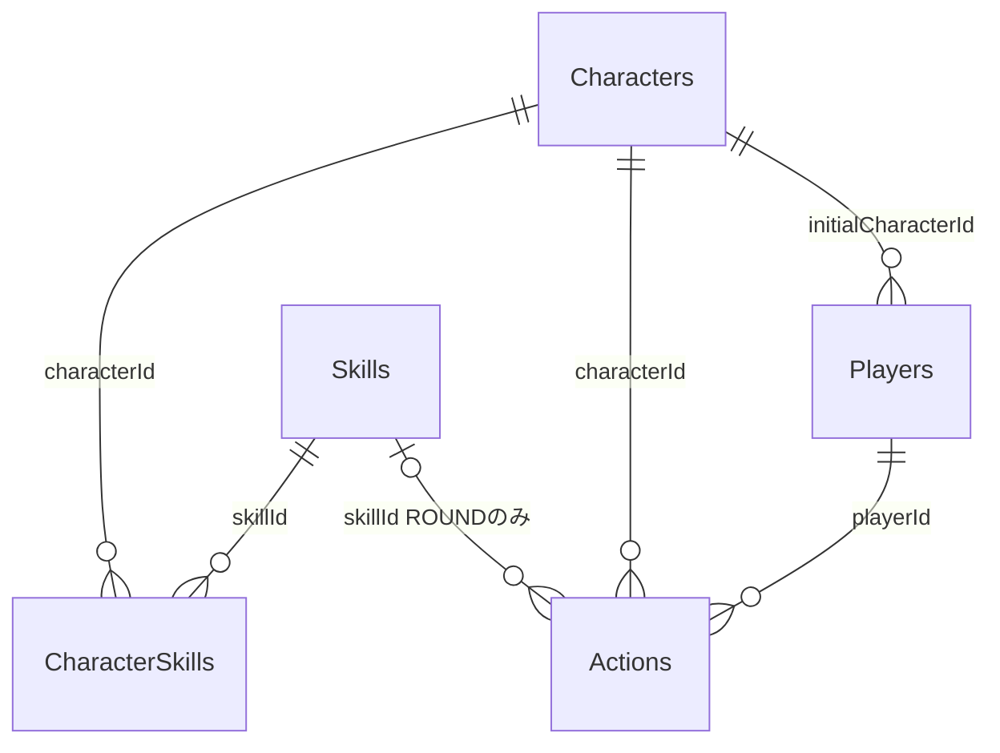

# 05 データモデル — スキルじゃんけんラボ

2026-10-26改訂。ゲーム仕様を基準にDBを再設計した。物理スキーマ2・ゲームマスター2を現行とする。設計とローカルコードを変更し、実DBの変更・移行・検証実行はまだ行っていない。[判断理由](adr/0004-rebuild-game-database.md)／[作業記録](tasks/03_active/database-redesign.md)。

## 設計方針

P001の1人・成功操作200件・仲間3体・基本スキル3種・適性6組に限定する。画像・合成・通貨・スキル解放は存在しない。Google Sheetsを継続し、ゲーム用6表と任意のセリフ管理2表を置く。

マスターと行動の事実を保存する。所有仲間、習得一覧、累計スコア、勝敗、加算点はそこから復元できるため保存しない。以前の入力・結果・次状態JSONの重複をなくす。ゲームの1操作は引き続きActionsへの1行追記だけであり、所有表・スコア表との複数書込みを必要としない。

SheetsにトランザクションやPK・FKの強制を期待せず、アプリが型・キー・関連・履歴を検証する。不完全行があれば停止し、自動初期化や過去行への巻戻しをしない。

## 物理テーブル

列は次の順序に固定する。1行目は完全一致のヘッダー、以後はデータ。余分な列・途中空行・欠落キーは拒否する。日時はUTCのミリ秒付きISO文字列。数値は安全な整数、booleanは実際の真偽値とし、文字列の数字・trueは認めない。

| 表 | 列（左から順） | キー・制約 |
|---|---|---|
| Players | playerId, displayName, initialCharacterId, createdAt | PK playerId、P001の1行。initialCharacterIdはCharactersへのFK、C01固定 |
| Characters | characterId, name, sortOrder, active | PK characterId、C01〜C03の3行。sortOrderは1〜3で一意、active=true |
| Skills | skillId, name, effectCode, bonus, active | PK skillId、S01〜S03の3行。効果は下表、bonus=1、active=true |
| CharacterSkills | characterId, skillId | 複合PK、双方にFK、下記6組に一致 |
| Actions | actionId, playerId, seq, requestId, payloadHash, type, datasetId, characterId, skillId, playerHand, cpuHand, createdAt, schemaVersion, masterVersion, recordHash | 15列。追記専用、最大200行。詳細は後述 |
| Settings | key, value | PK key。MASTER_VERSION=2、MAX_ACTIONS=200、SCHEMA_VERSION=2の3行だけ |

Players.displayName、Characters.name、Skills.nameは前後空白なし・1〜32 Unicodeコードポイント・制御文字なし。初期名は「たんけんたい」「ひのこ」「しずく」「このは」と下表。表示名の変更とマスター行の並べ替えは参照を壊さない。Actionsは物理行順もseqと一致させる。

| skillId | 初期名 | effectCode | 適性を持つ仲間 |
|---|---|---|---|
| S01 | かちのひらめき | WIN_BONUS | C01 / C03 |
| S02 | まけてもいっぽ | LOSE_BONUS | C01 / C02 |
| S03 | あいこのわ | DRAW_BONUS | C02 / C03 |

効果・適性・初期所有・得点計算はmasterVersion=2の不変条件。表示名以外の仕様変更はマスター版と移行設計を改訂する。Settingsの版番号だけを手編集して互換扱いにしない。

Recipes、Assets、assetId、initialStateJson、inputJson、resultJson、stateJsonは物理スキーマ2に作らない。新ブックに旧Recipes/Assetsが混在した場合も停止する。旧ブックの表・列は後述の読取り互換としてそのまま保管する。

## Actionsのデータ辞書

| 列 | 型・意味・制約 |
|---|---|
| actionId | サーバー採番UUID、PK、大文字小文字を区別せず一意 |
| playerId | PlayersへのFK、P001固定 |
| seq | 成功操作の連番、1〜200、欠落・重複禁止。playerId＋seqが一意 |
| requestId | 要求UUID。playerId＋requestIdが一意、大文字小文字を区別しない。新規保存は小文字 |
| payloadHash | 正規化した要求のSHA-256。再送内容の一致判定 |
| type | DRAW / ROUNDのみ |
| datasetId | 要求元ブックID文字列のcanonical JSONをSHA-256化した64桁小文字hex。実Drive IDを公開しない |
| characterId | CharactersへのFK。DRAWは獲得仲間、ROUNDは対戦に選んだ所有仲間 |
| skillId | ROUNDではSkillsへのFKかつ当該仲間とのCharacterSkillsが存在。DRAWでは空文字 |
| playerHand | ROUNDではrock / scissors / paper、DRAWでは空文字 |
| cpuHand | サーバーが抽選した手。ROUNDではrock / scissors / paper、DRAWでは空文字 |
| createdAt | サーバー保存時刻、UTCのISO文字列 |
| schemaVersion | 物理スキーマ版2 |
| masterVersion | 計算に使うゲームルール・マスター版2 |
| recordHash | この列を除く全列をキー名付きオブジェクトとしてcanonical JSON化したSHA-256 |

DRAWのcharacterIdは、その時点で未所有の有効仲間に限る。ROUNDのスキルは初期習得済みかつ適性ありに限る。初期仲間とDRAWの合計で所有を決め、重複獲得を認めない。公開要求からCPUの手・得点・勝敗・任意playerIdは受け取らない。

payloadHashの対象は `{op,expectedVersion,datasetId,payload}`。DRAWはpayload={}、ROUNDは `{characterId,skillId,hand}`、expectedVersionはseq−1。オブジェクトキーを再帰的に辞書順へ並べ、UTF-8でSHA-256化する。requestIdはハッシュ対象外。

recordHashはCPUの手や獲得仲間など、入力ハッシュだけでは保護されない保存結果の誤編集も検出する。署名・改ざん防止機構ではなく、権限を持つ編集者が再計算した変更や末尾行の削除まで検知する保証はない。編集権限を提供者に限定し、試遊中の直接編集を禁止する。

## 関連と復元する状態



| 論理的なデータ | 復元元 | 永続化しない理由 |
|---|---|---|
| 所有仲間 | Players.initialCharacterId＋DRAW.characterId | 取得の事実との二重更新を避ける |
| 習得済みスキル | マスター2の有効なS01〜S03 | 全種初期習得で、個別の習得操作がない |
| 対戦結果 | ROUNDの双方の手＋skillId＋固定ルール | 勝敗・基本点・加算は決定的に再計算できる |
| 累計スコア | 全ROUNDの得点合計 | ポイント消費がなく、独立した残高表が不要 |
| version | 最終seq、0件は0 | 二重保存せず履歴に一致させる |
| 選択中の仲間・スキル | ブラウザー内の画面状態 | ゲーム進行の正本ではない |

初期状態はversion 0、points 0、所有C01、習得S01〜S03。最大200行を順に読み、記録済みの獲得仲間・CPUの手から各時点のresult/stateを復元する。この処理で乱数・外部AIを呼ばない。復元後のAPI状態は既存画面との契約を維持する。

```json
{"schemaVersion":1,"version":0,"points":0,"ownedCharacterIds":["C01"],"unlockedSkillIds":["S01","S02","S03"]}
```

上のstate.schemaVersion=1はAPIの状態表現の版であり、物理DBのSCHEMA_VERSION=2とは別物。bootstrap.data.storageSchemaVersion=2とmasterVersion=2を返す。ID配列は一意・昇順。最新10件も同じ復元結果を使う。基本6表の取得後の復元計算はメモリー内で行い、行ごとのSheets RPCやセリフRPCを追加しない。

## 保存・再送

1. 変更要求の型・許可項目・UUID・4096バイト以下を確認する。
2. ScriptLock.tryLock(3000)を取得し、失敗ならBUSY。
3. 接続先を読み直し、全マスター・全履歴を検証。物理2／マスター2以外のゲーム操作はLEGACY_DATA_READ_ONLY。
4. 接続ブックのdatasetIdを照合。不一致ならDATASET_MISMATCH。
5. 既存requestIdを検索。同一payloadHashなら当該操作直後のresult/stateを復元してreplayed=trueで返す。異なるならREQUEST_ID_CONFLICT。
6. expectedVersion、200件上限、所有・適性を判定。順序は再送検索より後。
7. 新規要求だけ乱数を引いて計算。計算結果と状態差分を検証し、15列の記録を作る。
8. 追加後の全履歴をメモリー上で検証し、1行setValues→flush→対象行照合→全表再読込を行う。
9. 成功結果を返す。例外時もfinallyでロックを解放する。

保存済み結果を再送で返す際は現在の最新状態とは限らないため、その後bootstrapで同期する。失敗・読取りではseqを増やさない。完全な保存行があれば応答喪失後も同じ要求で回収できる。不完全行の場合は停止する。

ブラウザーは要求全体をsessionStorageへ保持する。masterVersionとdatasetIdで保存先を分け、別ブックへ旧要求を再送しない。タブ復帰・履歴復帰・手動更新ではneedsSyncを先に立て、取得失敗後は古い状態から変更しない。未解決要求を自動送信せず、手動再送で解決する。

## 管理画面のセリフデータ

ゲーム6表とは別に、管理者が明示初期化する任意の2表。両方がない場合は定型文で稼働する。片方欠落や不正値があれば管理処理を停止し、ゲーム向け読取りは空の採用集へフォールバックする。

| 表 | 列 | 制約 |
|---|---|---|
| DialogueDrafts | slotKey, revision, textsJson, generationRequestId, updatedAt | PK slotKey。C01〜C03×WIN/LOSE/DRAWの9枠、固定順。revision非負整数。0は空配列と空の生成ID、1以上はUUIDと1〜3文 |
| DialoguePublication | id, version, catalogJson, updatedAt | PK id=CURRENTの1行。versionはcatalog内と一致。版0は空集、以後最大9枠・各1〜3文 |

文は日本語を含む40 Unicodeコードポイント以内・重複なし、HTML等の禁止文字を拒否する。JSONセルは8192バイト以下、日時はUTC。詳細な文面制約・管理認可は[AIセリフ設計](specs/ai-battle-dialogue.md)。

ここでは下書き1枠・採用集全体をそれぞれ1行で保存するため、意図的に境界の明確なJSONを使う。文を複数行に分けて公開途中の集をゲームへ返す構造にはしない。公開はロック内の版比較・1行保存・flush・再読込。下書きはゲームへ配信しない。bootstrapで採用済み集を1回取得し、対戦中はブラウザー内で選ぶ。

## 設定の保存先

| 保存先 | 内容 |
|---|---|
| Settings | MASTER_VERSION、MAX_ACTIONS、SCHEMA_VERSIONだけ |
| Script Properties | JANKEN_SPREADSHEET_ID、JANKEN_PREVIOUS_SPREADSHEET_ID、GEMINI_API_KEY、GEMINI_TEXT_MODEL、JANKEN_AI_TEXT_ENABLED、JANKEN_ADMIN_EMAIL |
| Script Propertiesの生成制御 | JANKEN_AI_DAILY（日次20試行・停止状態）、JANKEN_AI_JOB_UUID（最大200予約・入力ハッシュ・状態・日付・モデル・プロンプト版） |
| ブラウザー | 表示状態・採用集キャッシュ・同じ要求の手動再送用情報。APIキーや実Drive IDは渡さない |

生成の予約・回数はGASプロジェクト全体の上限とし、DB切替・移行・復元で消去しない。外部生成はロック外で行い、同じUUIDで二度呼ばない。SheetsバックアップにはGASコード・Script Properties・旧画像ファイル本体は含まれない。

## 旧形式と移行

| 物理スキーマ | マスター | 用途 |
|---|---|---|
| 1 | 1 | 合成ありの旧記録。旧ルールで読取り・コピー照合だけ。新ゲームへ自動変換しない |
| 1 | 2 | 合成廃止後のJSON保存形式。読取り・コピー照合と、別ブックへの明示移行が可能 |
| 2 | 2 | 現行ゲーム。新規保存・管理画面に使用 |

旧8表のヘッダー・値・JSON・payloadHashは変えない。読取り互換コードをlegacy-schema.js / legacy.jsへ分離する。旧物理形式はマスター2であっても公開ゲーム・管理操作から拒否する。

`migrateLab_(sourceId)`／`operator migrate SOURCE_ID`は物理1・マスター2だけを対象とする。ロック内で元データと管理表を検証し、検証付きバックアップを作り、別の物理2ブックへ変換する。actionId・requestId・seq・入力ハッシュ・記録時刻・結果・状態・初期作成時刻・管理2表を維持する。新行のrecordHashを計算し、復元状態と全操作の入出力が元と一致し、元データが不変の場合だけ移行先IDを返す。成功しても接続先は切り替えない。途中失敗のコピーは未採用として残す。

コピー・移行先のブックIDは変わるため、過去行のdatasetIdは記録当時の値を保持し、新規要求には新ブックのdatasetIdを用いる。切替前に旧ブックで保留要求を解決・照合する。古い要求を新しいIDで再発行しない。

マスター1からはゲームルールが異なるため、旧記録を保管したうえで`create`で新規ゲームを作成する。`activate NEW_ID OLD_ID`は想定接続先・新物理形式・非公開所有・管理表を確認し、旧ブックをバックアップしてから切り替える。自動移行・自動リセット・本番のその場上書きは行わない。[運用手順](08_release_runbook.md)に従う。

## 障害・拡張・検証

不完全行・キー重複・関連不整合・計算不能・ハッシュ不一致はDATA_INTEGRITY_ERROR。停止した現状をまず証跡コピーし、正常なバックアップを別ブックへ復元して照合する。200件到達時も別ブックの新規ゲームへ切り替え、履歴を削除して続行しない。

1人・200件を超える場合はこの全履歴復元方式を再評価し、トランザクションを備えたDB、所有・習得・対戦の専用テーブル、適切な索引へ移行する。現段階で可変レシピ・画像・汎用設定・複数プレイヤーの表は追加しない。

テストコードはヘッダー・型・PK/FK・並べ替え・記録ハッシュ・決定的復元・上限・再送・部分失敗・旧形式互換・非破壊移行に対応する。利用者の指示により今回は実行せず、[最終検証](tasks/03_active/mvp-release-verification.md)にまとめる。既存の46件PASSを本変更の検証結果として扱わない。
