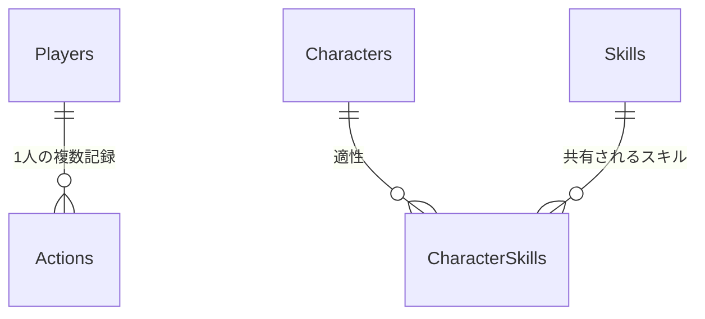

# 05 データモデル — スキルじゃんけんラボ

反映日：2026年10月26日。初期資料（退避済み）：[03_設計基礎書.md](archive/スキルじゃんけんラボ_企画・仕様・設計/03_設計基礎書.md)・[02_仕様書.md](archive/スキルじゃんけんラボ_企画・仕様・設計/02_仕様書.md)（v1.0）。

本書は現行仕様を定義する。ローカル実装・検証済み範囲と未完了の実環境確認は[最新記録](tasks/03_active/mvp-release-verification.md)および[テスト戦略](07_test_strategy.md)で区別する。参照元と本書の役割・更新規約は[索引](00_index.md)を参照。

## 設定の置き場所

| 種別 | 保存先・扱い |
|---|---|
| APIキー・テキストモデルID・管理AI有効化設定・管理者メール・Spreadsheet ID | GASのScript Properties。編集者は提供者に限定。キーをHTML・Sheets・ブラウザ保存領域・ログへ出さない。画像モデル・画像フォルダーの参照は撤去対象 |
| ゲーム全体の設定 | Settingsシート。新規MASTER_VERSION=2、MAX_ACTIONS=200、SCHEMA_VERSION=1（旧版1は保管用） |
| 旧画像データ | Assetsシートは過去データ互換用に保管。新ゲームでは未使用。Drive IDを画面へ出さない |
| プレイヤーの現在状態 | 最新Actions行のstateJson。0件のときだけPlayers.initialStateJson |
| 未解決の変更要求 | 端末のsessionStorageに要求全体を保持。現在状態の正本にしない |
| 選択中の仲間・スキル | 端末内の表示状態。各対戦要求で送信し、サーバーで検証 |
| ローカル開発用設定 | 既存env/・doppler.yamlはひな形。GASへの同期は未実装。秘密情報はコミットしない |

①土台作成で設定読込名を `JANKEN_SPREADSHEET_ID` / `JANKEN_DRIVE_FOLDER_ID` / `GEMINI_API_KEY` / `GEMINI_IMAGE_MODEL` と定義した。②で新規8表の作成・初期マスター検証・読取とAssets登録を実装した。初期化済みブックは検証のみで上書きしない。③で全Actionsの検証・追記・最新状態復元・同一要求の再送を実装した。0件時だけ初期状態を使い、不正行があればDATA_INTEGRITY_ERRORで停止する。ゲーム固有の操作生成・画面もローカル実装済み。

## 保存方針

Sheetsをデータベース同等の複数テーブル取引として扱わない。所有・ポイント・習得を別々のシートへ逐次更新すると、途中失敗時の復旧が重くなる。

そこで初版は、成功した操作1件ごとに、入力・結果・操作後の小さな状態スナップショットをActionsへ1行追記する。最新行のstateJsonを正とし、プレイヤーの現在状態を別の表に二重保存しない。正常な1操作では1回の行書込みだけを行う。

この方式は1人・200件までのデモに限った簡略化。Sheetsに厳密なDBトランザクションや障害時の完全な原子性を保証させる設計ではない。不完全行を見つけたら停止し、管理者がバックアップと照合する。

多対多の学習対象は実際の正規化テーブルCharacterSkillsで維持する。状態JSONは運用を小さくするための実装上の選択であり、「リレーショナル設計では何でもJSONにする」という教材にはしない。

## シート・状態・関連データ

### 共通ルール

- スプレッドシート1冊に以下のゲーム用8シートを置く。セリフ管理は後述の任意2表を追加する。1行目をヘッダー、2行目以降をデータとする。
- IDは不変の文字列。主キーは重複禁止、外部キーは存在確認を行う。Sheets自体は外部キー制約を強制しない。
- 日時はUTCのISO 8601文字列、表示はAsia/Tokyo。ポイント・連番・バージョンは非負整数。
- boolean列は真偽値を使う。列順を固定し、起動時にヘッダー一致を検証する。
- マスター編集は提供者だけが行い、デモ中は編集しない。検証完了後にMASTER_VERSIONを更新する。
- 子どもからの自由入力文字列を保存しない。IDと列挙値を許可リストで検証する。

### シート定義

以下は既存データと互換性を保つ8表のスキーマ。Recipesは旧合成、AssetsとassetId列は旧画像機能の履歴として保管し、新仕様のゲーム機能には使用しない。既存行の削除や移行は今回行わない。

| シート | 列（左から順） | キー・制約 |
|---|---|---|
| Players | playerId, displayName, initialStateJson, createdAt | PK playerId。初版P001のみ。初期JSONはversion 0 |
| Characters | characterId, name, assetId, sortOrder, active | PK characterId。assetIdは旧互換列（新規は空）。active=trueのみ抽選候補 |
| Skills | skillId, name, effectCode, bonus, assetId, active | PK skillId。新規はS01〜S03・3種の効果コードだけ、bonus=1 |
| CharacterSkills | characterId, skillId | 複合PK (characterId, skillId)。双方にFK |
| Recipes | recipeId, ingredientA, ingredientB, pairKey, resultSkillId, cost, active | 旧版の互換用。新規マスターではヘッダーのみ・データ0行 |
| Assets | assetId, sourceFileId, webpFileId, mimeType, byteSize, version, status, promptVersion, modelId, generatedAt | 旧PK assetId。旧状態はDRAFT/READY/REJECTED。既存データの保管専用 |
| Actions | actionId, playerId, seq, requestId, payloadHash, type, inputJson, resultJson, stateJson, createdAt, schemaVersion, masterVersion | PK actionId。FK playerId。playerId＋seq、playerId＋requestIdが一意 |
| Settings | key, value | PK key。新規MASTER_VERSION=2、MAX_ACTIONS=200、SCHEMA_VERSION=1（旧版1は保管用） |

AssetsのDrive IDはサーバー内で扱い、クライアントに返さない。sourceFileIdは生成元の画像、webpFileIdは変換後の採用画像。APIキー・フォルダーID・スプレッドシートIDはSettingsではなくScript Propertiesに置く。

### 状態JSON

```json
{
  "schemaVersion": 1,
  "version": 0,
  "points": 0,
  "ownedCharacterIds": ["C01"],
  "unlockedSkillIds": ["S01", "S02", "S03"]
}
```

新規pointsは全ROUNDのearnedPointsの累計で、消費・減算しない。unlockedSkillIdsはS01〜S03の3要素で固定する。

配列は重複なし・昇順。現在選択中のキャラとスキルはサーバー状態に含めず、各対戦リクエストで送る。stateJsonのversionはActions.seqと一致し、成功する変更ごとに1増える。読み取り・失敗操作では増えない。

Actionsが0件ならPlayers.initialStateJsonを使う。行があるのに壊れていた場合は、正常な過去行へ黙って戻らない。初版の最大サイズでは状態JSONは十分小さいが、各JSONセルを8KB以下に検証し、無制限の履歴や画像を埋め込まない。

### 初期関連データ

新規masterVersion=2のCharacterSkillsは次の6行とする。

```csv
characterId,skillId
C01,S01
C01,S02
C02,S02
C02,S03
C03,S01
C03,S03
```

新規RecipesとAssetsはヘッダーのみ（データ0行）。Characters/SkillsのassetIdは空文字。旧ブックのR01・S04・Assetsは保管し、今回の文書変更で削除しない。

### リレーション



現行ゲームのリレーションは上の3本で表す。旧画像・合成の表は教材用対応図に含めない。所有は状態JSON内の集合であり、将来DBへ移す場合はPlayerCharactersへ分離する。

## 排他・再送・保存の流れ

変更処理はScriptLockで直列化する。ロックは取得後に必ず解放する。[LockService公式資料](https://developers.google.com/apps-script/reference/lock/lock-service)。

```text
1. 入力の型・サイズ・操作名を検証する。
2. ScriptLock.tryLock(3000) が失敗したら BUSY。
3. ロック内でマスター、Players、Actionsを読み直し、全行の整合性を検証。
4. masterVersion=2とdatasetIdを検証し、不一致では書込しない。requestIdが既存ならpayloadHashを比較する。
   一致 → 保存済みresult/stateを返す（replayed=true）。
   不一致 → REQUEST_ID_CONFLICT。
5. 最新versionとexpectedVersionを比較。不一致ならVERSION_CONFLICT。
6. 行動数200件以上ならOP_LIMIT。
7. 所有・初期習得・適性・手などの業務条件を検証する。
8. ここで初めて乱数を引き、結果と次状態を計算する。
9. actionIdを採番し、必要な全列を1行のsetValuesで書き込む。
10. SpreadsheetApp.flush()後に対象行を再読込し、内容を検証する。
11. resultとstateを返す。finallyでロックを解放する。
```

payloadHashは `{op,expectedVersion,datasetId,payload}` の安定したJSON表現に対するSHA-256。新規操作には材料配列が存在しない。クライアントが送るハッシュを信用しない。再送時は既存要求の検索をversion・件数上限より先に行う。

新規masterVersion=2の行動typeはDRAW / ROUNDのみ。旧SYNTHESISは版1の保管用検証だけで扱う。seqは最新version+1。Actionsは追記専用とし、ゲームコードから既存行を上書きしない。プレイヤーごとの連番に欠落・重複がないこと、requestId一意、JSON型、state.version、参照ID、非負ポイント、保存済み結果からの状態差分を検証する。

スクリプトロックはシートの人手編集を止めない。Sheetsは所有者以外に編集権限を付けず、デモ中の手編集をしない。

### 再送と復元

- 新仕様では起動時にbootstrapでdatasetId/masterVersionを取得して当該ブックの保留要求を選別する。旧キーの要求を見つけても新ブックへ送信しない。
- 送信前にrequestIdを `crypto.randomUUID()` 等で作り、要求全体をsessionStorageへ保持する。
- 失敗時は同じID・同じ入力・同じexpectedVersionでのみ再送する。乱数や加算をやり直さない。
- 成功確認後に保留要求を消す。再読込で保留があれば先に同じ要求を解決し、その後bootstrapを取得する。
- replayed=trueのstateは当該操作直後の状態であり、現在の最新とは限らない。再送解決後はbootstrapで同期する。
- タブを閉じて保留要求を失っても、次回bootstrapは保存済みの最新状態を返す。画面操作を自動再実行しない。
- 結果表示中の再タップは新規要求を作らない。「もういちど」を押した次の対戦だけ新しいIDにする。
- 書込み例外後、同一要求が完全な1行として存在すれば再送で回収。不完全行があればDATA_INTEGRITY_ERRORで停止する。

自動再試行は初版では行わず、子ども向け再試行ボタンを用意する。勝敗計算テストでは乱数関数を引数注入できる構造にするが、公開APIには乱数固定機能を置かない。

## 廃止する画像データと新しいセリフ管理

画像生成・登録・WebP配信・画像キャッシュは撤去する。Assets表とCharacters/Skills.assetIdはv1の既存記録・バックアップの互換性のため残し、新規ゲームの表示・保存・生成AIでは利用しない。新コードの画像参照は撤去済み。旧版1の検証だけが旧Assetsを扱う。8表の列順や既存Actionsを今回の設計だけで書き換えない。

AIセリフはActionsに混ぜない。任意の追加2表DialogueDrafts（9枠の下書き）とDialoguePublication（公開版・採用集JSONの1行）で管理する。bootstrapは採用済み集だけを返し、プレイ中の生成や更新を行わない。公開はロック内で版比較・1行保存・flush・再読込を行う。管理生成の予約・日次回数はScript Propertiesに保持し、外部生成中はロックを解放する。追加2表もバックアップ照合の対象にし、旧8表だけの復元では定型文で稼働する。詳細は[現行設計](specs/ai-battle-dialogue.md)。
## 合成廃止に伴う版と旧記録の扱い

- 状態JSON・8表の列は維持しschemaVersion=1、新規ゲームのmasterVersionは2。新規Skillsは3行、CharacterSkillsは6行、Recipes/Assetsは空で初期化する。
- 旧masterVersion=1は4スキル・9適性・R01・SYNTHESIS・旧ハッシュ正規化を旧ルールで検証する。旧数値は当時のポイント残高であり、新しい累計スコアへ読み替えない。
- 旧データへの新ゲーム書込をLEGACY_DATA_READ_ONLYで拒否する。旧ブックの検証・バックアップ・コピー復元は維持する。MASTER_VERSIONだけを書き換えて新仕様扱いにしない。
- 新規版2ブックは別途の明示作成とし、接続先の切替前に旧ブックのバックアップと新規ブックの検証を行う。自動切替・履歴削除・過去のstateJsonやpayloadHashの修正は禁止。今回は文書変更のみで実データには触らない。
- 旧端末の保留synthesizeは自動再送しない。表示上で停止し、提供者が旧記録と照合して保留を解決する。新ブックへ旧要求を再発行しない。保留保存キーはmasterVersionとブックに対応する非秘密のデータセット識別子で分ける。実Drive IDは画面に返さない。
- 新仕様のAPIはS04・recipesを返さず、合成を受け付けない。旧記録の診断・復元は管理用の内部検証とし、ゲームに廃止機能を露出させない。

## スキーマ・マスター変更と復旧

- 名前の変更でもIDは維持する。キャラ・基本スキルの追加は、参照、適性、確率表示、画像、受入条件を一緒に更新する。
- マスター編集は提供者だけがデモ停止中に行う。変更前にSheetsをコピーし、検証後にMASTER_VERSIONを更新する。
- schemaVersionとmasterVersionを各Actionsに記録する。破壊的変更や既存記録との互換性に関わる変更は移行手順と検証を先に設計する。初版に自動migration・自動修復はない。
- 不完全行を見つけたら利用を停止し、現状コピーを保存してテスト用コピーで照合する。[リリース・復旧手順](08_release_runbook.md)に従い、過去行への黙った巻戻しやポイントの手修正をしない。
- 所有・習得の正規化テーブルへの分離、複数プレイヤーは次段階。[アーキテクチャ](02_architecture.md)の拡張境界を参照する。

## 関連タスク

[MVP実装計画](tasks/03_active/mvp-implementation.md)で初期データ・保存・再送の実装を追跡する。schema・設定・永続化方式の変更には目的、互換性、移行・復元、AC09〜AC13・AC21〜AC23への影響を記録する。

### ③の正規化・容量の実装詳細（旧masterVersion=1の履歴）

inputJsonは `{op,expectedVersion,payload}`。合成材料をソートした後、オブジェクトキーを再帰的に辞書順へ整列したJSONをUTF-8でSHA-256化する。配列は材料の正規化以外は順序を保持し、requestIdはハッシュに含めない。UUIDの照合は大文字小文字を区別しない。要求はJSON.stringify後の4096バイト以下、各JSONセルは8192バイト以下で検証する（KB表記の実装値）。所有・習得ID配列は一意かつ整列済み。時刻はUTCのミリ秒付きISO文字列。

全行のseq、actionId/requestId一意、schema/master版、入力ハッシュ、結果と次状態の差分を毎回検証する。書込前にも全体を検証し、setValues→flush→対象行照合→全体再読込をロック内で行う。Sheetsの手編集との競合や原子的トランザクションを保証するものではない。

旧画像キャッシュの仕様は廃止。標準カードの表示に画像RPCや画像設定を必要としない。

新規datasetIdはブックID文字列のcanonical JSONをSHA-256化した識別子。実IDを返さず、変更要求とinputJsonに含める。通常の初回成功は応答stateで表示を更新し、追加bootstrapを行わない。手動再送・replayed=true・競合時はbootstrapで最新化する。旧版1のハッシュにはdatasetIdを追加しない。

### 画面復帰時の同期

タブ復帰・履歴復帰・手動再読込では同期開始時点でneedsSyncを立てる。取得に失敗したら旧状態からの新規変更を止め、読取りの手動再試行を案内する。未解決の保留要求は自動送信しない。手動再送成功時は最新stateと保存済み結果を分けて表示する。
