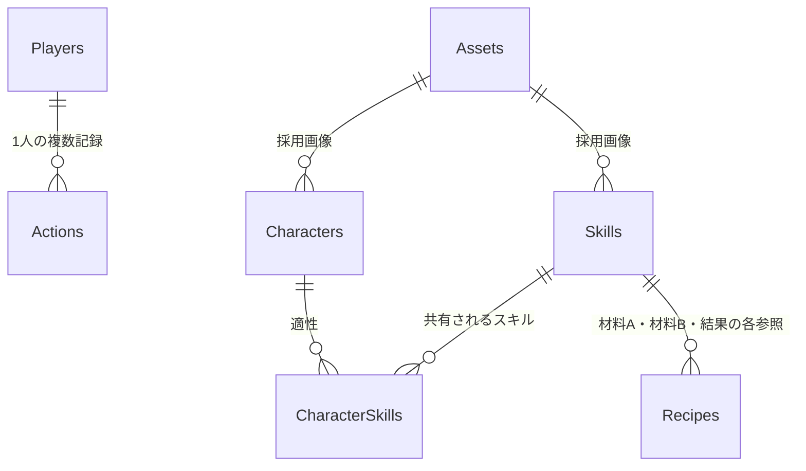

# 05 データモデル — スキルじゃんけんラボ

反映日：2026年10月26日。初期資料（退避済み）：[03_設計基礎書.md](archive/スキルじゃんけんラボ_企画・仕様・設計/03_設計基礎書.md)・[02_仕様書.md](archive/スキルじゃんけんラボ_企画・仕様・設計/02_仕様書.md)（v1.0）。

本書は提案仕様をプロジェクト用に整理した設計文書。アプリ実装・受入試験・公開は未完了であり、実績や試験合格を示さない。参照元と本書の役割・更新規約は[索引](00_index.md)を参照。

## 設定の置き場所

| 種別 | 保存先・扱い |
|---|---|
| APIキー・画像モデルID・Spreadsheet ID・DriveフォルダーID | GASのScript Properties。編集者は提供者に限定。キーをHTML・Sheets・ブラウザ保存領域・ログへ出さない |
| ゲーム全体の設定 | Settingsシート。MASTER_VERSION=1、MAX_ACTIONS=200、SCHEMA_VERSION=1 |
| 元画像と採用画像の対応・版 | Assetsシート。Drive IDはサーバー内だけで扱う |
| プレイヤーの現在状態 | 最新Actions行のstateJson。0件のときだけPlayers.initialStateJson |
| 未解決の変更要求 | 端末のsessionStorageに要求全体を保持。現在状態の正本にしない |
| 選択中の仲間・スキル | 端末内の表示状態。各対戦要求で送信し、サーバーで検証 |
| ローカル開発用設定 | 既存env/・doppler.yamlはひな形。GASへの同期は未実装。秘密情報はコミットしない |

①土台作成で設定読込名を `JANKEN_SPREADSHEET_ID` / `JANKEN_DRIVE_FOLDER_ID` / `GEMINI_API_KEY` / `GEMINI_IMAGE_MODEL` と定義した。②で新規8表の作成・初期マスター検証・読取とAssets登録を実装した。初期化済みブックは検証のみで上書きしない。現段階はActionsが0件のデータだけを扱い、行があればDATA_INTEGRITY_ERRORで停止する。Actionsの追記・最新状態復元は③以降で実装する。

## 保存方針

Sheetsをデータベース同等の複数テーブル取引として扱わない。所有・ポイント・習得を別々のシートへ逐次更新すると、途中失敗時の復旧が重くなる。

そこで初版は、成功した操作1件ごとに、入力・結果・操作後の小さな状態スナップショットをActionsへ1行追記する。最新行のstateJsonを正とし、プレイヤーの現在状態を別の表に二重保存しない。正常な1操作では1回の行書込みだけを行う。

この方式は1人・200件までのデモに限った簡略化。Sheetsに厳密なDBトランザクションや障害時の完全な原子性を保証させる設計ではない。不完全行を見つけたら停止し、管理者がバックアップと照合する。

多対多の学習対象は実際の正規化テーブルCharacterSkillsで維持する。状態JSONは運用を小さくするための実装上の選択であり、「リレーショナル設計では何でもJSONにする」という教材にはしない。

## シート・状態・関連データ

### 共通ルール

- スプレッドシート1冊に以下の8シートを置く。1行目をヘッダー、2行目以降をデータとする。
- IDは不変の文字列。主キーは重複禁止、外部キーは存在確認を行う。Sheets自体は外部キー制約を強制しない。
- 日時はUTCのISO 8601文字列、表示はAsia/Tokyo。ポイント・連番・バージョンは非負整数。
- boolean列は真偽値を使う。列順を固定し、起動時にヘッダー一致を検証する。
- マスター編集は提供者だけが行い、デモ中は編集しない。検証完了後にMASTER_VERSIONを更新する。
- 子どもからの自由入力文字列を保存しない。IDと列挙値を許可リストで検証する。

### シート定義

| シート | 列（左から順） | キー・制約 |
|---|---|---|
| Players | playerId, displayName, initialStateJson, createdAt | PK playerId。初版P001のみ。初期JSONはversion 0 |
| Characters | characterId, name, assetId, sortOrder, active | PK characterId。assetId→Assets。active=trueのみ抽選候補 |
| Skills | skillId, name, effectCode, bonus, assetId, active | PK skillId。effectCodeは4種の許可値、bonus=1 |
| CharacterSkills | characterId, skillId | 複合PK (characterId, skillId)。双方にFK |
| Recipes | recipeId, ingredientA, ingredientB, pairKey, resultSkillId, cost, active | PK recipeId。材料・結果→Skills。pairKey一意、cost=3 |
| Assets | assetId, sourceFileId, webpFileId, mimeType, byteSize, version, status, promptVersion, modelId, generatedAt | PK assetId。statusはDRAFT/READY/REJECTED。READYはWebP必須 |
| Actions | actionId, playerId, seq, requestId, payloadHash, type, inputJson, resultJson, stateJson, createdAt, schemaVersion, masterVersion | PK actionId。FK playerId。playerId＋seq、playerId＋requestIdが一意 |
| Settings | key, value | PK key。MASTER_VERSION=1、MAX_ACTIONS=200、SCHEMA_VERSION=1 |

AssetsのDrive IDはサーバー内で扱い、クライアントに返さない。sourceFileIdは生成元の画像、webpFileIdは変換後の採用画像。APIキー・フォルダーID・スプレッドシートIDはSettingsではなくScript Propertiesに置く。

### 状態JSON

```json
{
  "schemaVersion": 1,
  "version": 0,
  "points": 0,
  "ownedCharacterIds": ["C01"],
  "unlockedSkillIds": ["S01", "S02", "S03"]
}
```

配列は重複なし・昇順。現在選択中のキャラとスキルはサーバー状態に含めず、各対戦リクエストで送る。stateJsonのversionはActions.seqと一致し、成功する変更ごとに1増える。読み取り・失敗操作では増えない。

Actionsが0件ならPlayers.initialStateJsonを使う。行があるのに壊れていた場合は、正常な過去行へ黙って戻らない。初版の最大サイズでは状態JSONは十分小さいが、各JSONセルを8KB以下に検証し、無制限の履歴や画像を埋め込まない。

### 初期関連データ

CharacterSkillsは次の9行とする。

```csv
characterId,skillId
C01,S01
C01,S02
C01,S04
C02,S02
C02,S03
C02,S04
C03,S01
C03,S03
C03,S04
```

Recipesの初期1行：

```csv
recipeId,ingredientA,ingredientB,pairKey,resultSkillId,cost,active
R01,S01,S02,S01|S02,S04,3,true
```

pairKeyは材料ID2つを昇順に並べて `|` で結合する。同一材料2つは初版では拒否。素材数を可変にするRecipesIngredients中間テーブルは次段階とする。

### リレーション



RecipesにはSkillsへの外部キーが3本あり、図の線はそれらをまとめた概念表現。初版には所有用のPlayerCharactersテーブルはなく、所有は状態JSON内の集合である。将来DBに移行するならPlayerCharacters(playerId, characterId)とPlayerSkills(playerId, skillId)に切り出す。

## 排他・再送・保存の流れ

変更処理はScriptLockで直列化する。ロックは取得後に必ず解放する。[LockService公式資料](https://developers.google.com/apps-script/reference/lock/lock-service)。

```text
1. 入力の型・サイズ・操作名を検証する。
2. ScriptLock.tryLock(3000) が失敗したら BUSY。
3. ロック内でマスター、Players、Actionsを読み直し、全行の整合性を検証。
4. requestIdが既存ならpayloadHashを比較する。
   一致 → 保存済みresult/stateを返す（replayed=true）。
   不一致 → REQUEST_ID_CONFLICT。
5. 最新versionとexpectedVersionを比較。不一致ならVERSION_CONFLICT。
6. 行動数200件以上ならOP_LIMIT。
7. 所有・適性・レシピ・残高などの業務条件を検証する。
8. ここで初めて乱数を引き、結果と次状態を計算する。
9. actionIdを採番し、必要な全列を1行のsetValuesで書き込む。
10. SpreadsheetApp.flush()後に対象行を再読込し、内容を検証する。
11. resultとstateを返す。finallyでロックを解放する。
```

payloadHashは `op + expectedVersion + 正規化payload` の安定したJSON表現に対するSHA-256。合成材料はソートして正規化する。クライアントが送るハッシュを信用しない。再送時は既存要求の検索をversion・件数上限より先に行う。

行動のtypeはDRAW / ROUND / SYNTHESIS。seqは最新version+1。Actionsは追記専用とし、ゲームコードから既存行を上書きしない。プレイヤーごとの連番に欠落・重複がないこと、requestId一意、JSON型、state.version、参照ID、非負ポイント、保存済み結果からの状態差分を検証する。

スクリプトロックはシートの人手編集を止めない。Sheetsは所有者以外に編集権限を付けず、デモ中の手編集をしない。

### 再送と復元

- 送信前にrequestIdを `crypto.randomUUID()` 等で作り、要求全体をsessionStorageへ保持する。
- 失敗時は同じID・同じ入力・同じexpectedVersionでのみ再送する。乱数や加算をやり直さない。
- 成功確認後に保留要求を消す。再読込で保留があれば先に同じ要求を解決し、その後bootstrapを取得する。
- replayed=trueのstateは当該操作直後の状態であり、現在の最新とは限らない。再送解決後はbootstrapで同期する。
- タブを閉じて保留要求を失っても、次回bootstrapは保存済みの最新状態を返す。画面操作を自動再実行しない。
- 結果表示中の再タップは新規要求を作らない。「もういちど」を押した次の対戦だけ新しいIDにする。
- 書込み例外後、同一要求が完全な1行として存在すれば再送で回収。不完全行があればDATA_INTEGRITY_ERRORで停止する。

自動再試行は初版では行わず、子ども向け再試行ボタンを用意する。勝敗計算テストでは乱数関数を引数注入できる構造にするが、公開APIには乱数固定機能を置かない。

## 画像とキャッシュ

AssetsのREADY画像だけをマスター参照の許可IDで取得する。採用WebPは1枚512×512以下・100KiB以下、7枚合計700KiB以下。画像はJSONセルへ埋め込まない。画面内メモリはassetId＋versionで再利用し、画像変更時はAssets.versionを増やす。キャッシュは最新状態や重複判定の正本ではない。

## スキーマ・マスター変更と復旧

- 名前の変更でもIDは維持する。キャラ・スキル・レシピの追加は、参照、適性、確率表示、画像、受入条件を一緒に更新する。
- マスター編集は提供者だけがデモ停止中に行う。変更前にSheetsをコピーし、検証後にMASTER_VERSIONを更新する。
- schemaVersionとmasterVersionを各Actionsに記録する。破壊的変更や既存記録との互換性に関わる変更は移行手順と検証を先に設計する。初版に自動migration・自動修復はない。
- 不完全行を見つけたら利用を停止し、現状コピーを保存してテスト用コピーで照合する。[リリース・復旧手順](08_release_runbook.md)に従い、過去行への黙った巻戻しやポイントの手修正をしない。
- 所有・習得の正規化テーブルへの分離、複数プレイヤー、素材数可変のレシピは次段階。[アーキテクチャ](02_architecture.md)の拡張境界を参照する。

## 関連タスク

[MVP実装計画](tasks/02_backlog/mvp-implementation.md)で初期データ・保存・再送の実装を追跡する。schema・設定・永続化方式の変更には目的、互換性、移行・復元、AC09〜AC13・AC21〜AC23への影響を記録する。
