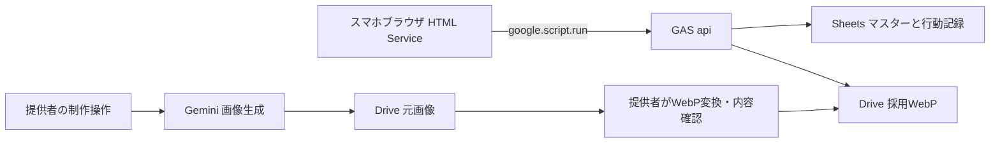
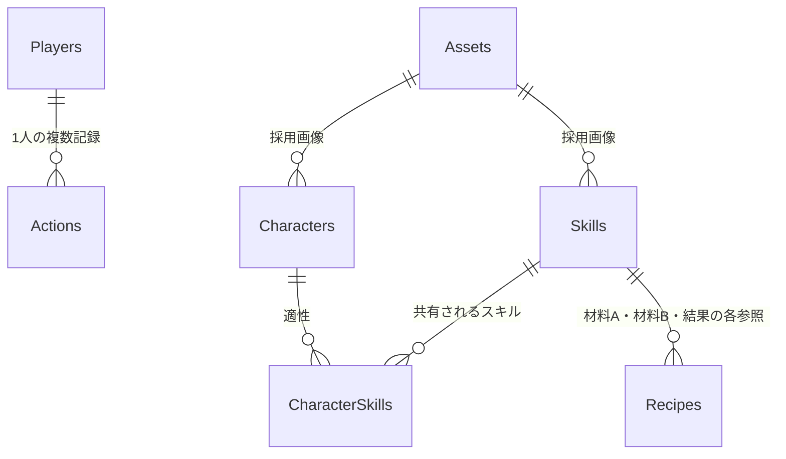

# 設計基礎書：スキルじゃんけんラボ

版：1.0 ／ 作成日：2026年10月26日 ／ 設計対象：GAS・Sheets・Drive・Geminiを使う最小MVP

関連文書：[企画書](01_企画書.md)・[仕様書](02_仕様書.md)

本書は実装の土台であり、完成済みコードや検証済みシステムを意味しない。初版は提供者の管理端末・本人限定公開・P001の1プレイヤーに限定する。

## 1. 全体構成



画面はGASの `doGet()` が返すHTML Service。画面からサーバーへの通信は非同期の `google.script.run` を使う。[Webアプリの公式説明](https://developers.google.com/apps-script/guides/web)、[HTML Serviceの通信](https://developers.google.com/apps-script/guides/html/communication)。

初版は同じGAS内の画面とサーバーを使い、独立したRESTサーバーや別ホスティングを用意しない。画像生成は制作時の処理であり、ゲームの変更処理に含めない。

## 2. 実装ファイルの責務

| ファイル案 | 責務 |
|---|---|
| Code.gs | doGet、公開関数api、操作名の許可リスト |
| GameService.gs | 抽選・対戦・合成・状態変更の制御 |
| Rules.gs | 勝敗、ポイント、レシピ正規化の副作用のない関数 |
| Repository.gs | Sheets一括読込、行動追記、整合性検証 |
| Assets.gs | 許可画像IDから採用WebPを取得 |
| Admin.gs | 初期データ作成、マスター検証、画像生成・登録、バックアップ補助 |
| Index.html | 5画面の骨組み |
| Styles.html | スマホ優先のCSS |
| Client.html | RPC、画面状態、結果モーダル、再送処理 |

内部・管理関数は末尾 `_` を付け、画面から呼ぶ公開関数は `api` に集約する。末尾 `_` の関数は `google.script.run` から呼び出せない。ただし、これは公開範囲の設定や入力検証の代替ではない。[公式通信ガイド](https://developers.google.com/apps-script/guides/html/communication)。

## 3. 保存方針：更新対象を1行にまとめる

Sheetsをデータベース同等の複数テーブル取引として扱わない。所有・ポイント・習得を別々のシートへ逐次更新すると、途中失敗時の復旧が重くなる。

そこで初版は、成功した操作1件ごとに、入力・結果・操作後の小さな状態スナップショットをActionsへ1行追記する。最新行のstateJsonを正とし、プレイヤーの現在状態を別の表に二重保存しない。正常な1操作では1回の行書込みだけを行う。

この方式は1人・200件までのデモに限った簡略化。Sheetsに厳密なDBトランザクションや障害時の完全な原子性を保証させる設計ではない。不完全行を見つけたら停止し、管理者がバックアップと照合する。

多対多の学習対象は実際の正規化テーブルCharacterSkillsで維持する。状態JSONは運用を小さくするための実装上の選択であり、「リレーショナル設計では何でもJSONにする」という教材にはしない。

## 4. データモデル

### 4.1 共通ルール

- スプレッドシート1冊に以下の8シートを置く。1行目をヘッダー、2行目以降をデータとする。
- IDは不変の文字列。主キーは重複禁止、外部キーは存在確認を行う。Sheets自体は外部キー制約を強制しない。
- 日時はUTCのISO 8601文字列、表示はAsia/Tokyo。ポイント・連番・バージョンは非負整数。
- boolean列は真偽値を使う。列順を固定し、起動時にヘッダー一致を検証する。
- マスター編集は提供者だけが行い、デモ中は編集しない。検証完了後にMASTER_VERSIONを更新する。
- 子どもからの自由入力文字列を保存しない。IDと列挙値を許可リストで検証する。

### 4.2 シート定義

| シート | 列（左から順） | キー・制約 |
|---|---|---|
| Players | playerId, displayName, initialStateJson, createdAt | PK playerId。初版P001のみ。初期JSONはversion 0 |
| Characters | characterId, name, assetId, sortOrder, active | PK characterId。assetId→Assets。active=trueのみ抽選候補 |
| Skills | skillId, name, effectCode, bonus, assetId, active | PK skillId。effectCodeは4種の許可値、bonus=1 |
| CharacterSkills | characterId, skillId | 複合PK (characterId, skillId)。双方にFK |
| Recipes | recipeId, ingredientA, ingredientB, pairKey, resultSkillId, cost, active | PK recipeId。材料・結果→Skills。pairKey一意、cost=3 |
| Assets | assetId, sourceFileId, webpFileId, mimeType, byteSize, version, status, promptVersion, modelId, generatedAt | PK assetId。statusはDRAFT/READY/REJECTED。READYはWebP必須 |
| Actions | actionId, playerId, seq, requestId, payloadHash, type, inputJson, resultJson, stateJson, createdAt, schemaVersion, masterVersion | PK actionId。FK playerId。playerId＋seq、playerId＋requestIdが一意 |
| Settings | key, value | PK key。MASTER_VERSION=1、MAX_ACTIONS=200、SCHEMA_VERSION=1 |

AssetsのDrive IDはサーバー内で扱い、クライアントに返さない。sourceFileIdは生成元の画像、webpFileIdは変換後の採用画像。APIキー・フォルダーID・スプレッドシートIDはSettingsではなくScript Propertiesに置く。

### 4.3 状態JSON

```json
{
  "schemaVersion": 1,
  "version": 0,
  "points": 0,
  "ownedCharacterIds": ["C01"],
  "unlockedSkillIds": ["S01", "S02", "S03"]
}
```

配列は重複なし・昇順。現在選択中のキャラとスキルはサーバー状態に含めず、各対戦リクエストで送る。stateJsonのversionはActions.seqと一致し、成功する変更ごとに1増える。読み取り・失敗操作では増えない。

Actionsが0件ならPlayers.initialStateJsonを使う。行があるのに壊れていた場合は、正常な過去行へ黙って戻らない。初版の最大サイズでは状態JSONは十分小さいが、各JSONセルを8KB以下に検証し、無制限の履歴や画像を埋め込まない。

### 4.4 初期関連データ

CharacterSkillsは次の9行とする。

```csv
characterId,skillId
C01,S01
C01,S02
C01,S04
C02,S02
C02,S03
C02,S04
C03,S01
C03,S03
C03,S04
```

Recipesの初期1行：

```csv
recipeId,ingredientA,ingredientB,pairKey,resultSkillId,cost,active
R01,S01,S02,S01|S02,S04,3,true
```

pairKeyは材料ID2つを昇順に並べて `|` で結合する。同一材料2つは初版では拒否。素材数を可変にするRecipesIngredients中間テーブルは次段階とする。

### 4.5 リレーション



RecipesにはSkillsへの外部キーが3本あり、図の線はそれらをまとめた概念表現。初版には所有用のPlayerCharactersテーブルはなく、所有は状態JSON内の集合である。将来DBに移行するならPlayerCharacters(playerId, characterId)とPlayerSkills(playerId, skillId)に切り出す。

## 5. API契約

### 5.1 公開入口と共通形式

`api(request)` を `google.script.run.withSuccessHandler(...).withFailureHandler(...).api(request)` で呼ぶ。通信順序に依存せず、画面側は変更を1件ずつ送る。JSONで表せる型のみを使用し、Dateオブジェクトではなく日時文字列を返す。

変更要求例：

```json
{
  "op": "playRound",
  "requestId": "68bc9177-bae2-4b17-ae17-b2cabf5cdf72",
  "expectedVersion": 2,
  "payload": {
    "characterId": "C01",
    "skillId": "S01",
    "hand": "rock"
  }
}
```

成功応答例（変更前ポイント2、相手がチョキの場合）：

```json
{
  "ok": true,
  "requestId": "68bc9177-bae2-4b17-ae17-b2cabf5cdf72",
  "replayed": false,
  "version": 3,
  "data": {
    "result": {
      "characterId": "C01",
      "skillId": "S01",
      "playerHand": "rock",
      "cpuHand": "scissors",
      "outcome": "WIN",
      "basePoints": 2,
      "bonusPoints": 1,
      "earnedPoints": 3
    },
    "state": {
      "schemaVersion": 1,
      "version": 3,
      "points": 5,
      "ownedCharacterIds": ["C01", "C02", "C03"],
      "unlockedSkillIds": ["S01", "S02", "S03"]
    }
  }
}
```

失敗応答例：

```json
{
  "ok": false,
  "requestId": "a4a45a39-92a0-4112-8a18-596a9553c9af",
  "error": {
    "code": "INSUFFICIENT_POINTS",
    "message": "あと1ポイントためよう",
    "retryable": false,
    "details": {"required": 3, "current": 2}
  }
}
```

業務エラーも成功ハンドラーにこの形式で返す。GASやネットワークの例外は失敗ハンドラーで扱い、変更結果は未確定とする。読み取り応答はrequestId=null、replayed=false。versionは状態を含む読み取りと変更成功で返し、画像応答では省略する。

### 5.2 操作別契約

| op | payload | 成功時のdata | 主な検証 |
|---|---|---|---|
| bootstrap | `{}` | `{player, state, characters, skills, characterSkills, recipes, masterVersion, limits}` | 初期状態・全マスター・Actionsの整合性 |
| drawCharacter | `{}` | `{result:{characterId, candidateCount}, state}` | 未所有候補がある |
| playRound | `{characterId, skillId, hand}` | `{result:{characterId, skillId, playerHand, cpuHand, outcome, basePoints, bonusPoints, earnedPoints}, state}` | 所有、習得、適性、手の許可値 |
| synthesize | `{ingredientSkillIds:["S01","S02"]}` | `{result:{recipeId, unlockedSkillId, spentPoints}, state}` | 配列長2、重複なし、固定レシピ、習得、未解放、残高 |
| getRelations | `{}` | `{player, recentActions, characters, skills, characterSkills, ownedCharacterIds, unlockedSkillIds}` | 最新10件のみ。トークンや内部パスを除く |
| getAsset | `{assetId:"A_C01"}` | `{assetId, version, mimeType, base64}` | マスターから参照するREADY画像のみ |

bootstrapのplayerは `{playerId, displayName}`。charactersは `{characterId,name,assetId}`、skillsは `{skillId,name,effectCode,bonus,assetId}`、characterSkillsは `{characterId,skillId}`、recipesは `{recipeId,ingredientA,ingredientB,resultSkillId,cost}` の配列。limitsは `{maxActions:200,remainingActions:n}`。

recentActionsは `{actionId,type,createdAt,result}` の配列で新しい順。payloadHashや入力の内部記録は返さない。getRelationsのversionは対応する状態のversion。画像ファイルが変わる場合はAssets.versionを増やす。

playerIdはクライアントから受け取らず、初版サーバー内でP001と決める。未知のop、未知のキー、必要項目不足を拒否する。変更要求全体は4KB以下、IDは英数字・`_`・`-`の32文字以内、requestIdはUUID形式に限定する。

## 6. 排他・再送・保存の流れ

変更処理はScriptLockで直列化する。ロックは取得後に必ず解放する。[LockService公式資料](https://developers.google.com/apps-script/reference/lock/lock-service)。

```text
1. 入力の型・サイズ・操作名を検証する。
2. ScriptLock.tryLock(3000) が失敗したら BUSY。
3. ロック内でマスター、Players、Actionsを読み直し、全行の整合性を検証。
4. requestIdが既存ならpayloadHashを比較する。
   一致 → 保存済みresult/stateを返す（replayed=true）。
   不一致 → REQUEST_ID_CONFLICT。
5. 最新versionとexpectedVersionを比較。不一致ならVERSION_CONFLICT。
6. 行動数200件以上ならOP_LIMIT。
7. 所有・適性・レシピ・残高などの業務条件を検証する。
8. ここで初めて乱数を引き、結果と次状態を計算する。
9. actionIdを採番し、必要な全列を1行のsetValuesで書き込む。
10. SpreadsheetApp.flush()後に対象行を再読込し、内容を検証する。
11. resultとstateを返す。finallyでロックを解放する。
```

payloadHashは `op + expectedVersion + 正規化payload` の安定したJSON表現に対するSHA-256。合成材料はソートして正規化する。クライアントが送るハッシュを信用しない。再送時は既存要求の検索をversion・件数上限より先に行う。

行動のtypeはDRAW / ROUND / SYNTHESIS。seqは最新version+1。Actionsは追記専用とし、ゲームコードから既存行を上書きしない。プレイヤーごとの連番に欠落・重複がないこと、requestId一意、JSON型、state.version、参照ID、非負ポイント、保存済み結果からの状態差分を検証する。

スクリプトロックはシートの人手編集を止めない。Sheetsは所有者以外に編集権限を付けず、デモ中の手編集をしない。

### 再送と復元

- 送信前にrequestIdを `crypto.randomUUID()` 等で作り、要求全体をsessionStorageへ保持する。
- 失敗時は同じID・同じ入力・同じexpectedVersionでのみ再送する。乱数や加算をやり直さない。
- 成功確認後に保留要求を消す。再読込で保留があれば先に同じ要求を解決し、その後bootstrapを取得する。
- replayed=trueのstateは当該操作直後の状態であり、現在の最新とは限らない。再送解決後はbootstrapで同期する。
- タブを閉じて保留要求を失っても、次回bootstrapは保存済みの最新状態を返す。画面操作を自動再実行しない。
- 結果表示中の再タップは新規要求を作らない。「もういちど」を押した次の対戦だけ新しいIDにする。
- 書込み例外後、同一要求が完全な1行として存在すれば再送で回収。不完全行があればDATA_INTEGRITY_ERRORで停止する。

自動再試行は初版では行わず、子ども向け再試行ボタンを用意する。勝敗計算テストでは乱数関数を引数注入できる構造にするが、公開APIには乱数固定機能を置かない。

## 7. Gemini画像生成とWebP

### 7.1 初版の制作工程

1. 提供者がキャラ3件・スキル4件の固定プロンプトを用意する。
2. GASエディタから管理関数 `generateAsset_(assetId)` を実行する。Script PropertiesのキーとモデルIDを使い、Gemini APIを呼び出す。
3. 応答の画像パートを探す。画像がない、拒否された、429/5xxになった場合は失敗として記録し、READYにしない。
4. 返されたMIMEタイプを確認し、元画像を非公開のDriveフォルダーへ保存する。拡張子だけをWebPに変えない。
5. 提供者が元画像を取得し、手元の画像編集ソフト、またはローカルのCanvas変換ページで512×512以下のWebPへ変換する。
6. 大人が内容を確認し、採用WebPをDriveへアップロードする。
7. `registerWebp_(assetId, fileId)` でサイズ・MIME・ファイルのWebPヘッダーを検証し、AssetsをREADYにする。

画像生成対応モデルは実装日に利用可能なものを選び、`GEMINI_IMAGE_MODEL` に設定する。APIから画像データを取得する方式は[Geminiの画像生成公式資料](https://ai.google.dev/gemini-api/docs/image-generation)を確認する。アプリのゲーム仕様は特定モデルに依存させない。

管理関数は `https://generativelanguage.googleapis.com/v1beta/models/{model}:generateContent` を呼ぶ方式を想定し、モデルに合わせた画像出力設定を使う。キーは `x-goog-api-key` ヘッダーに入れ、URLやログに含めない。モデルごとの対応フィールドは公式資料の実装時点の例に合わせる。

自動WebP変換までGASだけで完結させることは初日の必須範囲にしない。必要なら提供者用ローカルページで `canvas.toBlob(..., 'image/webp', 0.82)` を使い、返されたBlobのMIMEタイプを確認する。WebP非対応時は別の変換手段を使う。

### 7.2 プロンプト案

キャラクター共通：

> 小学生向けのじゃんけん教育ゲームのオリジナルキャラクター。［ひのこ／しずく／このは］をテーマに、親しみやすい丸い形、太い輪郭、明るい配色。正方形の中央に全身を大きく配置。背景は単色。文字、ロゴ、既存作品のキャラクター、実在人物は含めない。怖い表現を避け、同じカードシリーズとして統一する。

スキル共通：

> 同じ教育ゲームで使う正方形のスキルアイコン。［勝ちのひらめき／負けても一歩進む／あいこの輪／探究の光］を、一目で分かる1つの象徴として描く。太い輪郭、明るい配色、単色背景。文字や数字は含めない。キャラクターカードと調和する絵柄。

生成画像は表示前に提供者が確認し、採用しないものはREJECTEDにする。元プロンプトの版・モデルID・生成日時を記録する。子どもの氏名・顔写真・入力内容を生成APIに送らない。

### 7.3 配信とサイズ制約

- 採用画像は1枚100KiB以下、512×512以下を目標兼登録条件にする。7枚で合計700KiB以下。
- getAssetはAssetsの許可IDからだけDrive Blobを読み、WebPのbase64を返す。画面はdata URLとして表示する。
- base64は元バイナリより約1/3大きくなるため、初回に全画像をまとめて返さない。画面内メモリでassetId＋versionごとに保持する。
- Drive共有URLを画像配信用の公開URLとして使わない。画像が多くなる段階で専用ストレージと配信方式へ移す。
- 画像生成の試行上限は初日14回（7枚×最大2回）を目安に提供者が管理する。料金は利用モデルの現行条件で確認し、ゲームから追加課金が発生する経路は作らない。

## 8. 公開・セキュリティ

### 初版の配置

1. 提供者のアカウントでSheetsとDriveフォルダーを作り、共有を制限する。
2. GASにSpreadsheet ID、Driveの保存先、Geminiキー、モデルIDを設定する。
3. 提供者が必要な権限を確認して初回認可する。
4. Webアプリを実行ユーザー「自分」、アクセス範囲「自分のみ」に相当する設定でデプロイする。
5. 提供者のスマホで動作を確認し、別アカウントからはアクセス不可であることを確認する。

利用するアカウント種別や組織ポリシーによって利用可能な公開設定が異なる。本人限定を選べない場合、安易に公開範囲を広げず、開発用の本人アクセスで試す。実行ユーザーとアクセス権の意味は[公式Webアプリ資料](https://developers.google.com/apps-script/guides/web)を参照する。

### 実装上の制限

- APIキーをHTML・Sheets・ブラウザ保存領域に入れない。Script Propertiesはスクリプト編集者が扱えるため、編集者を提供者に限定する。
- apiに任意のplayerId、Drive fileId、スプレッドシート名、任意URLを指定する機能を作らない。
- 手、スキル、レシピ、ポイントはサーバーで検証・計算する。クライアントが送る勝敗や加算値は採用しない。
- 名前・エラー表示はtextContent等で挿入し、シート文字列をHTMLとして解釈しない。
- リクエストのサイズを制限し、個人情報・認証情報をログに残さない。
- キャッシュは性能向上の補助に限り、最新状態や重複判定の正本にしない。
- 「URLを知っている人だけ」「隠した管理ボタン」だけを認可とみなさない。

一般公開する場合は認証済み主体とplayerIdのサーバー側対応、各操作の所有権確認、レート制限、利用上限、ログと削除運用を別途設計する。本人限定のapiをそのまま匿名公開しない。

## 9. 運用・障害対応

| 場面 | 提供者の手順 |
|---|---|
| デモ開始前 | マスター参照・画像7枚・初期データ・公開範囲を確認 |
| 日々の確認 | Apps Scriptの実行失敗、Actions件数、Gemini制作時の利用量を確認 |
| 保存前後 | デモ前とデモ終了時にSheetsを日時付きでコピー。マスター変更前にも保存 |
| 通信失敗 | 同じ要求の再送で確認。記録を見ずにポイントを手修正しない |
| 不完全行 | 利用停止→Sheetsコピー→requestIdと直前状態を照合→テスト用コピーで修復検証 |
| 画像失敗 | 代替表示で続行し、AssetsとDrive権限を確認 |
| 200件到達 | Sheetsをコピーしてデモ記録を保管し、管理関数でP001のActionsだけを初期化 |
| リセット時 | 端末の保留要求を消し、タブを閉じて開き直す。古いタブからの送信を防ぐ |
| 復元 | バックアップコピーでマスター版と全行を検証し、テスト用GASから先に確認 |
| デモ終了後 | 試遊記録は原則30日で見直し、不要なコピーも削除。画像素材は別管理 |

初版には削除・復旧用の子ども向けボタンを置かない。バックアップは変更履歴の代替として保管するが、これだけで無停止運用を保証しない。

Apps Scriptや関連サービスには実行時間・呼出し数等の割当があり、上限はアカウント種別等で異なる。数値を固定前提にせず[公式クォータ一覧](https://developers.google.com/apps-script/guides/services/quotas)を実装日に確認する。200件は本アプリの設計上の上限であり、Googleの保証された容量上限ではない。

## 10. 実装順と確認単位

1. マスターの初期化と検証を作る。CharacterSkillsが9行、レシピ1行、初期状態が仕様と一致することを確認する。
2. Rulesの勝敗9組とスキル加算12組、レシピ順序の正規化を確認する。
3. 変更処理を1行追記でつなぎ、同一requestId再送・競合・応答喪失を確認する。
4. 5画面をつなぎ、保存後に演出する。
5. 画像生成・変換・登録・配信を確認する。
6. 学習画面をマスターとActionsから描画し、線の数と習得状態を確認する。
7. 仕様書AC01〜AC23を実機とテスト用データで実施し、結果を記録する。

## 11. 拡張時に変更する場所

| 拡張 | 追加・変更が必要なこと | 初版との境界 |
|---|---|---|
| キャラ・固定スキル追加 | マスター、画像、適性、受入条件の更新 | 効果コードが既存ならロジック追加は不要 |
| 新しい効果 | Rulesの許可コード・表示・試験を追加 | AIが任意コードや効果値を決めない |
| 3素材以上の合成 | RecipeIngredientsと数量、在庫消費を設計 | 初版の2素材・非消費とは別仕様 |
| 個別プレイヤー | 認証、主体からのID解決、所有権検証、記録分離 | 固定P001を置き換える |
| 教室での同時利用 | 負荷測定、運用管理、保存先選定 | ScriptLockの全体直列化がボトルネックになる |
| DBへの移行 | PlayerCharacters、PlayerSkills、対戦表、取引・一意制約 | JSONスナップショットを正規化した現在状態へ移す |
| 遊び中の画像生成 | 非同期ジョブ、上限、確認、再試行、待機画像 | 合成成功と画像完成を別状態で管理 |
| 一般公開 | 認証、監視、レート制限、年齢に応じた運用、問い合わせ・削除 | 公開設定の変更だけでは足りない |

## 12. 公式資料と確認範囲

2026年10月26日に参照した資料。動作や料金を実測した結果ではない。

- [Apps Script Web Apps](https://developers.google.com/apps-script/guides/web)：配信と実行主体・アクセス設定。
- [HTML Service communication](https://developers.google.com/apps-script/guides/html/communication)：非同期呼出し、データ型、内部関数の扱い。
- [LockService](https://developers.google.com/apps-script/reference/lock/lock-service)：同時実行の排他制御。
- [Apps Script quotas](https://developers.google.com/apps-script/guides/services/quotas)：実行上限と利用量の制約。
- [Gemini image generation](https://ai.google.dev/gemini-api/docs/image-generation)：画像生成APIとモデル別の呼出し方法。

これらのサービス仕様と、本書で提案したゲームルール・200件制限・7画像・1日計画は区別する。後者は本MVPを小さく完成させるための設計判断である。
