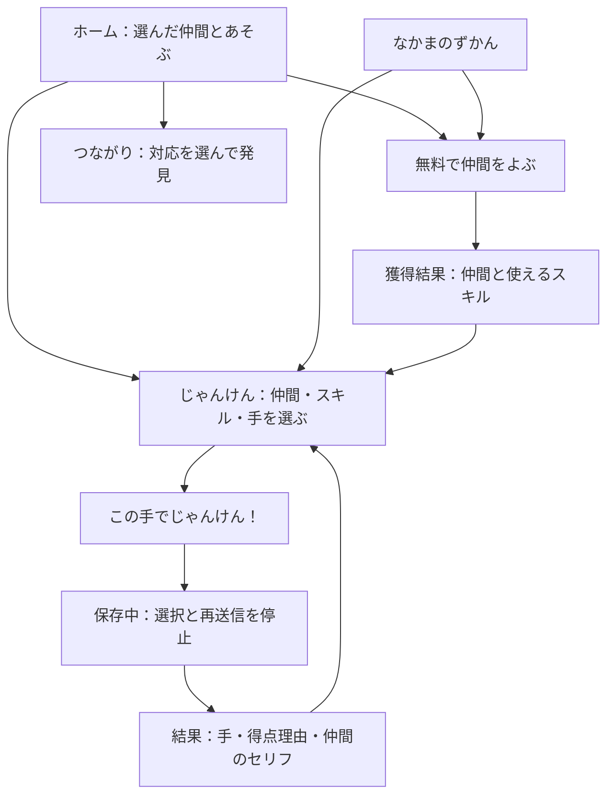

# UI/UX再設計：あそぶ・ためす・つながる

2026-10-26。現行ゲームの基本機能を、初めての子どもが次の操作を見つけられる構成へ再設計する。ローカル実装済み。画面描画・操作試験・実機検証・実GAS反映はまだ実施していない。

## 目的と範囲

従来の画面は保存状態のパネルが大きく、抽選・対戦への入口が同じ重さで並び、手を押すとすぐ送信していた。管理画面は9枠を縦に並べ、未選択でも公開ボタンが押せた。

本改訂ではホームの主操作を対戦へ統一し、選択と送信を分ける。保存待ちや応答不明は状態と次の操作を対にして示す。結果の得点理由と継続導線を明確にする。生成AI・DB・ゲームルール・本人限定の公開範囲は維持する。

## 情報設計と移動

下部の4項目は「ホーム／なかま／じゃんけん／つながり」。スマートフォンでも1列で配置する。画面切替で見出しへフォーカスを移す。ナビ操作そのものはゲーム状態を変更しない。つながり画面の読取り以外は、画面切替のために通信を追加しない。

## 画面ごとの仕様

| 画面 | 優先して見せる内容 | 主操作 | 補助操作 |
|---|---|---|---|
| ホーム | あそびの案内・選んだ仲間・対戦入口 | じゃんけんへ | 無料抽選、つながりへの問い |
| なかま | 3体の肖像・名前・所有状態・使えるスキル | 所有仲間であそぶ | 無料抽選、収集数の確認 |
| じゃんけん | 1仲間 → 2スキル → 3手の順で選択 | この手でじゃんけん！ | 得点ルールを開く |
| 対戦結果 | 双方の手・勝敗・加算内訳・セリフ | もういちど、手をえらぶ | とじる／Escape |
| 仲間獲得結果 | 獲得した仲間・使えるスキル | このなかまとあそぶ | とじる／Escape |
| つながり | 仲間×スキル対応表・選択した関係の説明 | 行・列を選んで発見 | 最新10件の絞込み、大人向けの仕組み説明 |

### ホームと仲間

総ポイントとプレイヤー名はヘッダーに小さくまとめる。ポイントは累計スコアで、消費・交換できるような表現をしない。ホームは対戦を主ボタン、抽選を補助ボタンとする。抽選は「無料」「未所有から等確率」「重複しない」と明記し、3体そろった後は抽選ボタンを完了表示へ置き換える。

仲間は炎・しずく・葉の形、色、表情、名前で区別する。未所有も名前と適性は見られるが選択できない。画像ファイル・生成画像・画像通信を使わない。所持数やチェックマークは実データだけから表示する。

### 対戦の選択と送信

- 所有仲間はラジオカード、適性のある習得済みスキルは名前・条件付き加点を持つラジオカードで選ぶ。
- 手は3つの押しボタン。選択状態を背景・枠・aria-pressed・確認文で示す。押した時点では送信しない。
- 手の初期選択はなし。「この手でじゃんけん！」は選択するまで無効。
- 仲間を変更した場合は手を未選択に戻す。スキル変更はローカルで反映し、開いたルール欄の得点も更新する。
- 決定ボタンを押したときだけ既存playRoundを1回送信。送信中は仲間・スキル・手・決定を無効にし、保存中であることを知らせる。
- 通信待ちの間に偽の勝敗・得点・完了率を出さない。長い演出やタイマーを追加しない。
- 正常保存後と手動再送の解決後は手を未選択へ戻す。「もういちど」は手の選択へ進むだけで、次の対戦を自動送信しない。

### 結果と学習

結果はモーダルで表示する。最初に勝敗、次に双方の手、得点合計と「基本＋スキル」、スキル発動理由、仲間のセリフを見せる。セリフの出典は折りたたんだ補足に置く。成功した記録の結果だけを表示する。再送結果は回収した記録であることをラベルで区別し、現在の合計を過去の状態へ巻き戻さない。

獲得結果からは獲得した仲間を選択した対戦画面へ進める。閉じる／Escapeは可能なら操作元、操作元が無効・消滅した場合は現在画面のナビへ戻す。主ボタンで次へ進んだ場合は次画面の見出しにフォーカスする。

対応表の表頭はS01などの内部IDではなく「勝ちで＋1」などの条件を表示する。行・列を押すと関連セルを強調し、スキル名と使える仲間を文章で知らせる。列見出しのアクセシブルな名前は正式なスキル名にする。主キー・中間テーブルなどの用語は「大人といっしょに、表のしくみを見る」にまとめる。履歴0件や絞込み結果0件にも次のあそびを案内する。

## 保存・障害時の体験

| 状態 | 表示と操作 |
|---|---|
| 初回読込 | 共通状態欄で読込中。未取得のゲームを仮データで見せない |
| 正常 | コンパクトな保存状態と手動読込ボタン |
| 保存中 | 保存中の文・状態マーク。選択と変更操作を無効化 |
| 応答不明 | 「届いたか確認する」案内と同一要求の手動確認ボタン。新規操作を止める |
| 再同期が必要 | 先に読込みを促し、古い状態からの変更を止める |
| データ不整合・保存領域不正 | 大人に確認してもらう案内。勝手な初期化や保留削除をしない |
| 200件到達 | デモ終了と説明し、仲間や履歴の閲覧は残す |
| 関係情報の読込失敗 | その画面で読取り再試行。ゲーム変更を自動でやり直さない |

保留要求・排他・冪等性・datasetId分離は既存処理を使う。起動または明示読込・復帰時のbootstrapで受け取った採用集を使い、対戦ごとのセリフ取得・AI生成を追加しない。

## 管理画面

冒頭に「生成 → 確認・選択 → 公開」を示す。採用済み枠数・下書きのある枠数・公開版、日次生成状態、未確認要求の案内を共通領域に集める。

最初はひのこの3勝敗を表示する。「しずく／このは／すべて」のローカル絞込みを設け、全9枠を毎回スクロールする必要を減らす。各枠を「ゲームで使う文」「候補を作る・選ぶ」に分ける。候補0件、定型文のみ、採用済みを明示する。候補が未選択なら公開ボタンは無効、選択後は対象の文数をボタンに表示する。

チェック状態はページ内でdatasetId・枠・下書きrevisionごとに保持する。同じ下書きなら絞込みや一覧再読込後も残し、新たなrevisionや別DBの候補へ引き継がない。ページ再読込時のチェック保持は行わない。新しい候補を自動で選択・公開しない。

処理中・未確認・読込失敗中はチェック変更も止める。採用解除は採用済み枠だけに表示する。生成・公開の成功後は対象枠の見出しへフォーカスを戻す。保存先の初期準備は生成を伴わないことを説明する。管理認可・同じUUIDの再生成禁止・回数制限・DB切替競合防止はサーバー側の既存処理を維持する。

## 見た目とアクセシビリティ

- 紙色の背景、点状の薄い模様、濃い緑の主操作、黄・水色・葉色の補助色。色だけで状態を示さない。
- ゲームの最大幅1120px。広い画面はホームと対戦を2列、仲間と管理枠は3列。760px以下で主要画面を1列へ変える。
- 360px幅を基準に表・ボタン・ナビを収める。長い名前は折返す。実描画の合否は最終検証で記録する。
- 主操作の高さ48px以上。本文16pxを基本とし、補助ラベルだけ小さくする。下部ナビは安全領域と本文の下余白を確保する。
- ラジオ・チェックボックス・fieldset/legend・table見出し・dialogを用いる。選択状態はaria属性で伝える。
- 画面見出しへのフォーカス、スキップリンク、キーボード操作、読み上げの状態通知を備える。
- 音声・外部フォント・追加画像通信なし。reduced-motionでは状態マークの点滅とトランジションを止める。

## 実装と確認先

実装はsrc/clientのindex / styles / app / admin / admin-app。API・DBの列・GAS実行ファイル数は変更しない。テストコードは選択中の通信ゼロ・決定時1要求・結果継続時の自動送信ゼロ・管理の絞込みとチェック保持へ更新した。

[実装タスク](../tasks/03_active/uiux-redesign.md)と[最終検証](../tasks/03_active/mvp-release-verification.md)で、コードの反映と描画・操作の合否を分けて追跡する。
